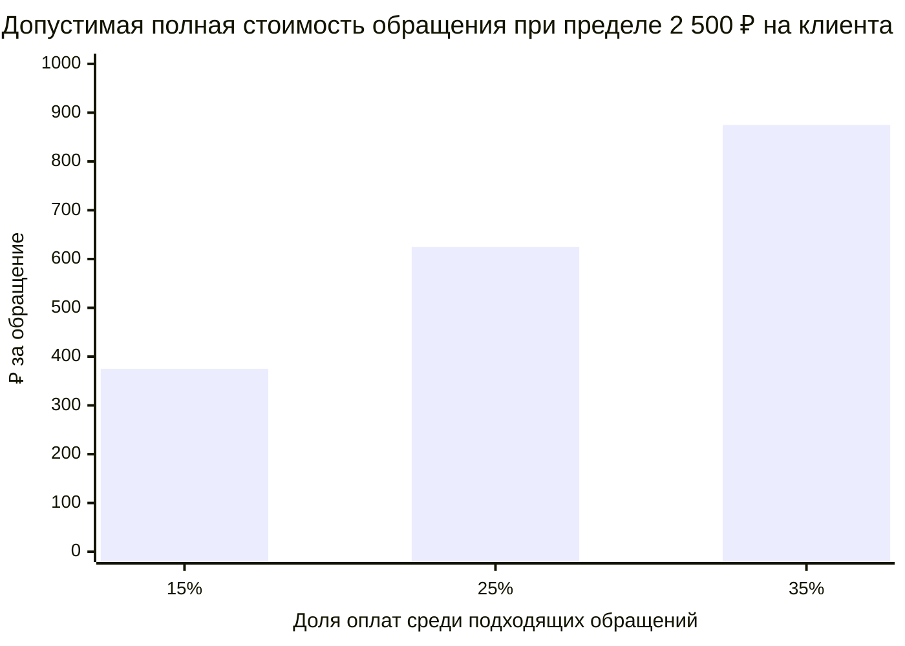

# Планирование рекламы и бюджета

Платное распространение позволяет приобрести доступ к аудитории через рекламную систему, автора или сообщество. Оно не создаёт спрос автоматически: человеку всё ещё нужны подходящее предложение, понятный следующий шаг и возможность получить обещанное. План рекламы соединяет эти условия с расходами и правилами принятия решений.

Сначала определите, какую неопределённость нужно уменьшить. Проверить интерес нового сегмента, заполнить конкретное мероприятие и поддержать регулярный поток обращений — разные задачи. Для первой полезен ограниченный пилот, для второй критичны сроки, для третьей — повторяемость экономики и мощность обработки.

## Проверьте готовность пути

До покупки размещения пройдите путь человека. Материал должен объяснять, кому полезно предложение, страница — подтверждать обещание, форма или сообщения — работать. Назначьте ответственного за ответы и передачу обращений в учёт.

Уточните доступность продукта. Если запись открыта только на неудобные часы или услуга временно недоступна, дополнительное распространение увеличит расходы и разочарование. Эти ограничения должны быть известны при выборе аудитории и формулировке объявления.

Подготовьте минимальный учёт: идентификатор размещения, размеченную ссылку, определение подходящего обращения и окно результата. Без него пилот покажет движение денег, но плохо объяснит, какая связка заслуживает повторения.

## Рассчитайте допустимую стоимость

Все числа далее учебные. Пусть вклад одного дополнительного заказа до маркетинга и общих расходов равен 4 000 ₽. Компания готова выделить на привлечение не более 2 500 ₽ на нового клиента в выбранном периоде. Это внутреннее решение с учётом остальных расходов и нужного остатка, а не универсальная норма.

Если из подходящих обращений оплачивают 25%, допустимая полная стоимость такого обращения при неизменной конверсии составит `2 500 × 0,25 = 625 ₽`. Для рекламной стоимости предел будет ниже, поскольку часть бюджета нужна на материалы и управление.

Историческая конверсия является допущением. Для новой аудитории рассчитайте варианты: при 15% оплат допустимая полная стоимость обращения — 375 ₽, при 35% — 875 ₽. Так видно, почему нельзя уверенно назначить рекламный бюджет по единственной ожидаемой цифре.

## Разделите бюджет по назначению

| Статья учебного пилота | Сумма |
| --- | ---: |
| Материалы и подготовка страницы | 15 000 ₽ |
| Управление и обработка | 10 000 ₽ |
| Первые размещения | 20 000 ₽ |
| Резерв на согласованное повторение | 15 000 ₽ |
| Предельные полные расходы | 60 000 ₽ |

Резерв не обязательно тратить. Он нужен, чтобы повторить перспективную связку или исправить обнаруженное препятствие. Не рассчитывайте стоимость клиента по всему пределу, если фактические расходы были ниже; отдельно показывайте план и факт.

Для покрытия 60 000 ₽ вкладом по 4 000 ₽ потребуются 15 дополнительных заказов. Но внутренний предел стоимости привлечения 2 500 ₽ означает более строгую цель: минимум 24 новых клиента при полной трате. Проверяйте обе границы и мощность бизнеса.

## Выберите ограниченное число проверок

Не дробите небольшой бюджет на десятки площадок и вариантов: каждый может получить слишком мало наблюдений. Выберите несколько различающихся гипотез, для которых хватает ресурсов на подготовку и последующий разбор.

Карточка проверки содержит аудиторию, предложение, формат, объём распространения, полные расходы, основной результат и срок ожидания. Укажите, что именно сравнивается. Одновременная смена автора, цены, страницы и формата покажет результат всей связки, но не объяснит вклад каждого элемента.

Согласуйте правила остановки. Неисправная форма, исчерпанная мощность и ложное обещание требуют оперативного вмешательства. Вывод об экономике делайте после достаточного периода, соответствующего циклу покупки. Отсутствие оплаты в первый день не равно провалу сложной услуги.

## Управляйте темпом расходов

Проверяйте ежедневные расходы, исправность переходов и качество первых обращений. Финальную оценку обновляйте по мере созревания когорт. Следите, чтобы команда успевала отвечать: увеличение бюджета при потерянных сообщениях меняет эффективность всей системы.

Платное и органическое распространение поддерживают друг друга, но имеют общие издержки производства. Зафиксируйте распределение этих расходов, чтобы не считать материалы бесплатными в одном канале и полностью платными в другом.

После пилота выберите следующее действие: повторить ограниченный объём, переработать предложение, улучшить обработку или остановиться. Результат отдельных размещений не гарантирует сохранения стоимости при масштабировании. Следующий бюджет также должен иметь предел, срок и проверяемую цель.

## Подготовьте запасной сценарий

Если размещение переносится или площадка становится недоступной, не расходуйте резерв автоматически. Сверьте, сохраняется ли задача: набор к прошедшей дате уже не нужен. Заранее определите, кто может перенести сроки, заменить формат или остановить оплату следующей партии.
