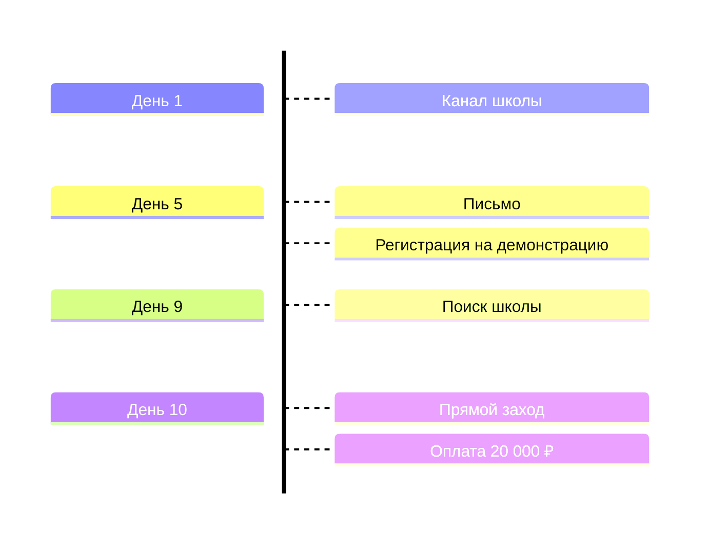
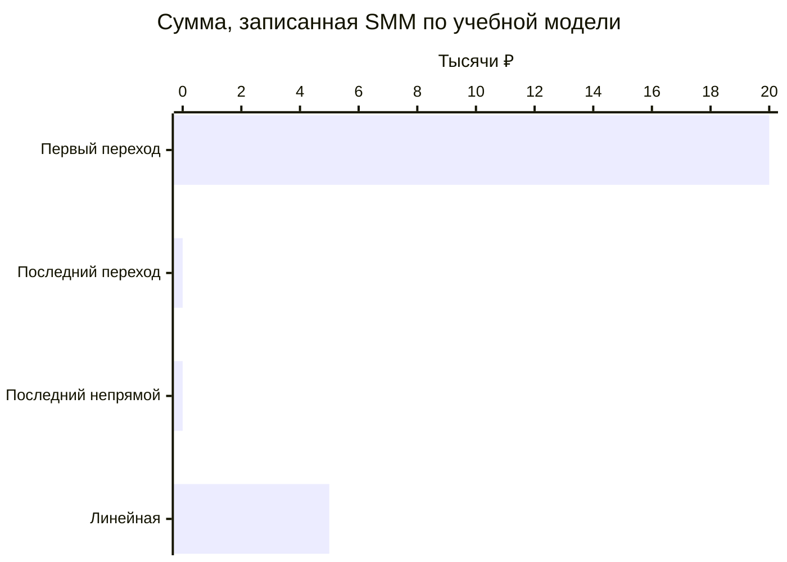

# Атрибуция и ограничения выводов

Атрибуция распределяет результат между зарегистрированными источниками контакта. Она отвечает на вопрос, как по выбранному правилу записать покупку в отчёт. Причинная оценка отвечает на другой вопрос: сколько покупок добавилось благодаря действию по сравнению с ситуацией, в которой этого действия не было.

Различие важно для бюджета. Клиент мог узнать о компании из рекомендации, прочитать канал и перейти по рекламной ссылке перед оплатой. Записать покупку рекламе по последнему переходу допустимо как правило учёта. Считать всю её выручку дополнительной из-за этой рекламы без дальнейшей проверки нельзя.

## Выберите правило и окно

Опишите, какие контакты доступны: переходы на сайт, ответы на вопрос менеджера, промокоды, обращения из сообщений. История почти всегда неполна. Часть контактов происходит без клика, в пересылках, на другом устройстве или вне измеряемой среды.

Затем определите результат: регистрация, заказ, оплата или сумма после возвратов. Модели могут по-разному распределять разные действия одного человека. Состав доступных данных и вопрос определяют выбор правила.

Окно атрибуции ограничивает давность контакта. Например, во внутреннем отчёте покупку можно связывать с переходами за 30 календарных дней до оплаты. Укажите, какие события участвуют и что происходит при отсутствии подходящего контакта. Это отдельное правило от окна оплаты после обращения и от календарных дат кампании.

## Учебная история одной покупки

Все данные примера условные. Возьмём [запуск программы школы](/funnels/launches). Человек впервые зарегистрировался в базе из соцсетей пять месяцев назад. В текущем запуске зарегистрированы четыре перехода на сайт:

| День | Зарегистрированный контакт |
| --- | --- |
| 1 | Перешёл из собственного канала школы на страницу программы |
| 5 | Перешёл из письма и зарегистрировался на демонстрацию |
| 9 | Вернулся из поиска по названию школы |
| 10 | Зашёл напрямую и оплатил 20 000 ₽ |

История связана с одним человеком по доступным идентификаторам. В примере распределяем одну оплату, окно — 30 календарных дней до неё, в расчёте только эти четыре перехода. Разговор с менеджером хранится в истории обработки, но не включён в набор каналов. Открытие письма без перехода тоже не участвует.

На временной шкале — четыре зарегистрированных перехода в текущем запуске. Первая регистрация пять месяцев назад остаётся за пределами этого 30-дневного окна.

Начало показанного пути — первый переход в выбранном окне. Оно не становится первым знакомством человека с компанией.

## Сравните модели на одних данных

Ниже — правила учебного внутреннего отчёта. Они показывают принцип распределения; доступность и точное поведение одноимённых моделей в сервисах проверяют отдельно.

| Модель | Куда попадут 20 000 ₽ | Для какого вопроса полезна | Что останется за пределами вывода |
| --- | --- | --- | --- |
| Первый переход в окне | SMM — 20 000 ₽ | Как начинается наблюдаемый путь в выбранном окне? | Последующая работа каналов не получает долю; это не обязательно первое знакомство с компанией |
| Последний переход | Прямой заход — 20 000 ₽ | Откуда начался визит перед оплатой? | Предшествующие контакты не получают долю |
| Последний непрямой переход | Поиск — 20 000 ₽ | Какой известный непрямой источник предшествовал оплате? | Поиск может завершать путь, начатый в других каналах |
| Линейная | SMM, письмо, поиск и прямой заход — по 5 000 ₽ | Как выглядит распределение при равных долях всех включённых переходов? | Равенство долей — допущение; оно не устанавливает равенство влияния |

В учебном правиле последнего непрямого перехода пропускаем прямые заходы; если других источников в окне нет, оставляем прямой. В линейной модели примера прямой заход включён. Другой набор событий даст другое распределение: сначала объявите правила, затем считайте.

Посмотрим только на сумму, записанную SMM по этим четырём правилам. Общая оплата во всех случаях одна и та же — 20 000 ₽.

Нулевой столбец означает, что правило записало оплату другому источнику. Контакт с SMM из истории не исчез, а разница между столбцами не показывает изменение продаж или причинного влияния канала.

Есть также модели с убыванием веса давних касаний и позиционные модели с повышенным весом начала и конца пути. В них нужно задавать параметры распределения. Более сложное правило само по себе не подтверждает, что выбранные веса отражают реальный вклад.

В моделях на основе данных доли или выбор источника рассчитывает алгоритм сервиса. Для интерпретации нужны его документация, доступные данные и ограничения. Не заменяйте отсутствующую историю уверенной ссылкой на автоматический расчёт.

## Выберите модель под решение

Для сравнения источников первого наблюдаемого входа полезен первый переход; для анализа визита перед оплатой — последний. Для работы с возвращениями сравните последний переход с правилом, пропускающим прямые заходы. Для изучения сочетаний каналов смотрите истории и распределение между касаниями, сохраняя общий итог заказов.

Зафиксируйте основную модель до сравнения результатов. Рядом можно показать альтернативную как проверку чувствительности: если оценка SMM резко меняется, вывод зависит от правила. Не выбирайте модель по тому, какая даёт каналу больше выручки. Ни одна из этих таблиц сама по себе не отвечает на вопрос, что произойдёт при отключении SMM.

Различайте три характеристики покупателя: он **был в базе до запуска**, его **первый переход в текущем окне был из SMM**, его **оплата по последнему непрямому переходу записана поиску**. Все три утверждения совместимы. Источник старой регистрации не превращается в новое привлечение, а продажа через поиск не стирает известные касания SMM.

При сокращении учебного окна до трёх календарных дней перед оплатой переходы первого и пятого дня не участвуют. Первый переход внутри нового окна окажется поисковым; история привлечения человека при этом не изменилась. Поэтому долю SMM нужно сопровождать моделью и окном, а затраты на создание базы — учитывать в согласованных границах экономики.

## Проверьте правила конкретного сервиса

Названия учебных моделей не означают, что все они доступны в выбранном счётчике. В [справке Метрики](https://yandex.ru/support/metrica/ru/reports/attribution-model) указаны изменения моделей с 20 мая 2026 года и собственное правило истории с перерывом в 90 дней, которое пользователь не может изменить. Это отличается от нашего учебного окна перед оплатой. Проверено 21 ноября 2026 года.

В [документации Google Analytics](https://support.google.com/analytics/answer/10596866?hl=en) указано, что первый клик, линейная, позиционная модель и убывание по времени больше не доступны в отчётах атрибуции с ноября 2023 года. Проверено 21 ноября 2026 года. Для собственного расчёта нужны выгрузки подходящей истории; нельзя обещать такой выбор в интерфейсе сервиса.

Практический вывод — показывать модель рядом с результатом и сравнивать источники внутри одинаковых правил. Если после смены модели доля SMM выросла, это изменение распределения в отчёте, а не свидетельство роста продаж.

## Почему отчёты не складываются

Рекламная система, сайт и CRM могут связывать одну покупку с разными контактами. В одном отчёте учитывается просмотр объявления, в другом только переход; различаются окна и правила устранения повторов. Сумма «конверсий» площадок может превышать реальное число заказов.

Для финансового итога используйте единый реестр заказов с устойчивым идентификатором, статусом оплаты и возврата. Отдельно сохраняйте заявления источников и результат внутренней модели. Такая структура позволяет изучать различия, не удваивая выручку.

Если у SMM было касание в пути, но оплата отнесена другому источнику, можно отдельно показать участие SMM в известной истории. Такой показатель иногда называют ассоциированной конверсией; определение зависит от отчёта. Один заказ может входить в истории нескольких каналов. Эти количества не складывают между собой и не прибавляют к атрибутированным заказам. Устройство общего учёта разобрано в [сквозной аналитике](/analytics/end-to-end).

Промокод также не решает задачу полностью. Его могут передать знакомому или опубликовать в другом месте; часть покупателей забудет код. Вопрос «откуда узнали» полезен как дополнительное свидетельство, но память человека не является полным журналом касаний.

## Как оценивать дополнительный эффект

Нужна сопоставимая группа или период, где воздействие отсутствует, а другие существенные условия совпадают настолько, насколько позволяет дизайн проверки. При случайном разделении доступной аудитории сравнивают результат группы воздействия с контрольной группой. До запуска определяют единицу распределения, показатель, срок и правила анализа.

Если воздействие можно разделить только по городам, учитывайте различия городов и малое число независимых групп. Если сравниваете месяцы, сезонность и другие кампании могут объяснить изменение. Такие наблюдения полезны, но ограничения должны сопровождать вывод, а не исчезать в презентации.

Даже эксперимент измеряет эффект конкретного воздействия в конкретных условиях. Результат короткого пилота нельзя без поправок распространить на год и многократно больший бюджет.

## Как представить вывод руководителю

Разделите отчёт на три утверждения: что зарегистрировано, как распределено и что известно о дополнительном эффекте. Например: «В CRM 12 оплаченных заказов с последним переходом из канала за 30 дней; эксперимент не проводился; дополнительное число заказов неизвестно».

Для планирования можно рассчитать несколько сценариев доли дополнительных заказов. Подпишите их как допущения и покажите чувствительность экономики. Это честнее и полезнее, чем выдавать один атрибутированный показатель за доказанную окупаемость.

Сохраняйте правила атрибуции вместе с выгрузкой и датой формирования. При повторном отчёте пересчитайте прошлые периоды той же моделью либо явно покажите разрыв. Тогда обсуждение бюджета будет опираться на сравнимые данные и понятные границы вывода.
