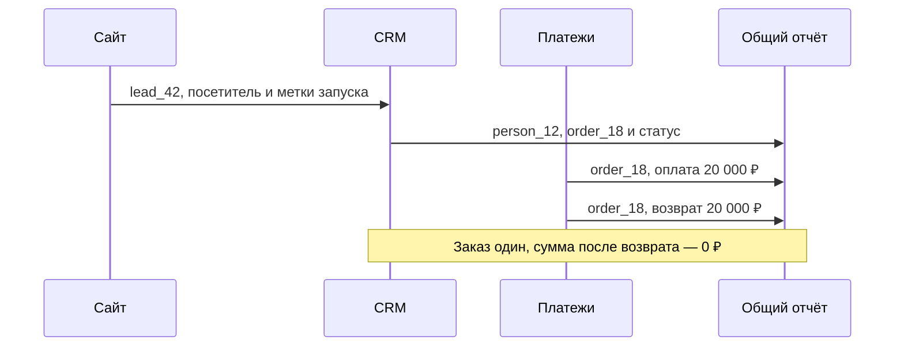

# Сквозная аналитика и место SMM

Сквозная аналитика соединяет расходы на привлечение, известные контакты с человеком, обращения, заказы, оплаты и возвраты. Она нужна, чтобы видеть результат пути через разные системы: подходящее обращение из соцсетей могло закончиться продажей у менеджера, а оплаченный на сайте заказ — последующим возвратом.

Сначала определите вопрос. Например: сколько денег потрачено на набор в программу, какие обращения дошли до оплаты и где в известных путях присутствовал SMM? Затем договоритесь об учёте. Готовый сервис или дашборд не заменяет правил соединения записей и распределения результата.

Используем [учебный запуск школы](/funnels/launches): 20 оплаченных заказов по 20 000 ₽, два полных возврата, 180 000 ₽ расходов кампании. Все данные и идентификаторы ниже вымышлены.

## Составьте карту данных

| Что учитываем | Где возникает | Чем связываем и кто отвечает |
| --- | --- | --- |
| Запуск и размещение | План кампании и реестр расходов | Идентификаторы запуска и размещения; владелец запуска и SMM |
| Переходы и события сайта | Система веб-аналитики | Идентификатор посетителя, время и метки; специалист по аналитике |
| Регистрация или обращение | Форма, переписка, звонок | Идентификатор обращения и доступная связь с посетителем; ответственный за интеграцию |
| Человек и история базы | CRM или согласованный реестр | Внутренний идентификатор человека, дата первого известного входа; владелец CRM |
| Заказ | CRM или система продаж | Идентификатор заказа и связь с человеком; продажи |
| Оплата и возврат | Платёжная или учётная система | Идентификаторы операции и заказа, сумма и дата; ответственный за платежи |
| Сводный результат | Общая таблица или хранилище | Те же идентификаторы, версия модели и дата выгрузки; аналитик и владелец запуска |

В маленькой команде роли можно совместить, а реестры вести в таблицах. У каждой строки всё равно должен быть владелец. Составьте задание на передачу данных: какие поля нужны, где возникают, куда должны попасть и каким примером проверить результат.

## Соедините записи по устойчивым идентификаторам

Идентификатор посетителя относится к учёту сайта, идентификатор человека — к записи в базе, идентификатор заказа — к покупке. Один человек может пользоваться несколькими устройствами и делать несколько заказов. Не считайте их одним и тем же объектом и не объединяйте людей только по совпадению имени.

Например, переход `visit_17` с меткой размещения связан с регистрацией `lead_42`, затем с человеком `person_12` и заказом `order_18`. Платёж и возврат сохраняют ссылку на `order_18`. При повторной регистрации человек остаётся `person_12`, а новый заказ получает собственный номер.

Храните операции отдельно от текущего состояния заказа. Повторная загрузка той же операции должна обновить или пропустить существующую запись, а не создать вторую оплату. Если к одному заказу присоединить четыре перехода, его сумма не должна стать в четыре раза больше. Сначала получите финансовый итог по заказу, затем применяйте модель распределения.

Передача идентификаторов требует настройки. Например, [документация Метрики по CRM](https://yandex.ru/support/metrica/ru/crm/about) описывает запись `ClientId` в форму и дальнейшую передачу в CRM. Это один из способов связать записи, а не гарантия узнавания человека на всех устройствах. Проверено 21 ноября 2026 года; конкретную интеграцию и её ограничения нужно проверять отдельно.

Для сообщений внутри соцсети или звонка связи с посетителем сайта может не быть. Используйте доступное подтверждённое поле источника и записывайте способ его определения. Ответ менеджеру, метка перехода и предположение сотрудника должны различаться. Не восстанавливайте отсутствующие касания догадкой. Доступ к идентификаторам и данным обращений организуйте по [правилам работы с персональными данными](/safety/personal-data).

## Сохраните источники и расходы

Для запуска задайте общий идентификатор, например `management_autumn`, а для каждого размещения — отдельный. Внешние ссылки получают согласованную [разметку](/analytics/tracking). Историю переходов сохраняйте отдельно: последний источник не должен затирать первый известный вход в базу.

В реестре расходов нужны дата, сумма, валюта, запуск, размещение и состав затрат. Общие материалы, труд и сервисы можно оставить общей строкой или распределить по объявленному правилу. Совпадение названия канала недостаточно: расходы одного запуска нельзя случайно соединить с заказами другого.

Сервисы могут принимать часть этих данных. Например, Метрика позволяет [загружать расходы](https://yandex.ru/support/metrica/ru/ad/expenses) с указанием источника или UTM-меток. Проверено 21 ноября 2026 года. Импорт расходов на размещения не означает, что в отчёт автоматически попали производство, труд и все остальные статьи бюджета.

## Разделите три представления результата

1. **Итог запуска:** один реестр показывает 20 оплат, два полных возврата и 360 000 ₽ после возвратов. Источник может быть неизвестен, но подтверждённая операция остаётся в итоге.
2. **Распределение по каналам:** выбранная [модель атрибуции](/analytics/attribution) присваивает результат источникам. Для полного распределения сумма по каналам, включая неизвестный источник, должна совпасть с общим итогом. При дробных долях учтите округление.
3. **Истории с участием SMM:** отдельно видно, в скольких известных путях были его касания, где они находились и какие вопросы помогали решать материалы. Пути могут одновременно включать SMM, письмо и поиск; их количества нельзя складывать в число покупателей.

Первое представление проверяет финансовую полноту, второе — распределение по правилам, третье — наблюдаемое участие в пути. Дополнительный эффект требует отдельной проверки. Даже подробная история не показывает автоматически, купил бы человек без SMM.

## Проверьте учёт на одном заказе

До кампании пройдите путь от размеченной ссылки до тестового заказа. Проверьте передачу источника и идентификаторов, затем оплату, повторную загрузку и возврат в тестовом режиме платёжной системы, если он доступен. Тестовые записи должны исключаться из рабочего итога.

После запуска сверяйте суммы оплат и возвратов с учётной системой. Отдельно показывайте долю заказов без связи с человеком, долю без определённого источника и число непривязанных операций. Это разные потери: наличие человека в CRM ещё не означает наличие истории переходов.

Если не все операции удаётся соединить, оставьте их в финансовой сверке и заведите задачу на исправление. Не удаляйте неудобные записи ради совпадения графиков. Сохраняйте дату выгрузки, часовой пояс, окно оплаты и версию модели: поздняя оплата или возврат меняют прежний результат.

## Начните с доступного уровня

Для небольшой команды достаточно реестра размещений и расходов, карточек обращений с источником и реестра заказов с оплатами и возвратами. Сначала свяжите их по идентификаторам и убедитесь, что итог воспроизводится. Автоматизируйте повторяющуюся передачу, когда понятны поля и правила.

При малом объёме данных используйте учёт для конкретных решений: исправить потерю источника, проверить неподходящие обращения, восстановить обработку или ограниченно повторить размещение. Дополняйте его вопросами клиентов и наблюдением за путём, сохраняя способ получения сведений. Если причинная проверка недоступна, планируйте [экономику по сценариям](/analytics/roi); неизвестный дополнительный эффект остаётся неизвестным.
