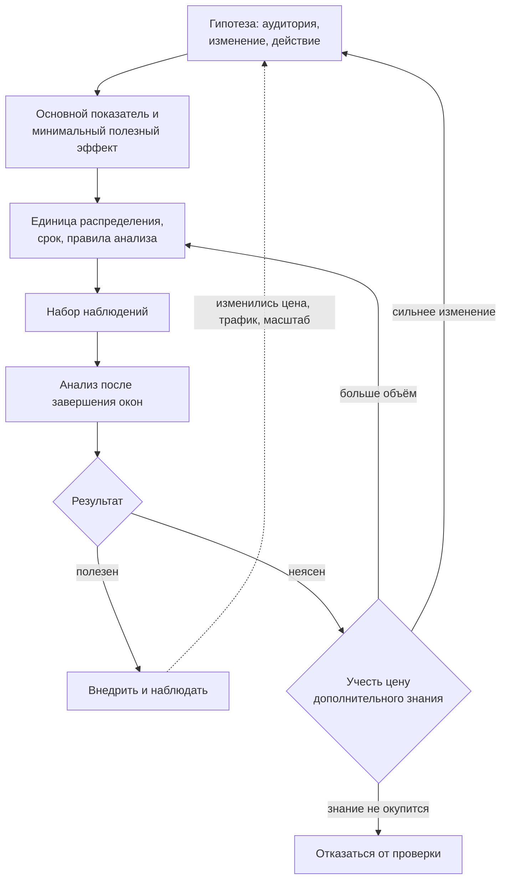

# Эксперименты и проверка гипотез

Эксперимент помогает проверить, меняется ли результат из-за конкретного воздействия. Например, делает ли новое объяснение услуги запись понятнее или добавляет ли рекламное размещение покупки. Для этого нужен способ сравнить результат с ситуацией без изменения, сохранив остальные существенные условия. Устройство контролируемых онлайн-экспериментов подробно разбирает книга [Trustworthy Online Controlled Experiments](https://experimentguide.com/).

Простое сравнение двух публикаций часто даёт полезное наблюдение, но слабое доказательство причины. Они могли выйти в разные дни, получить разный объём распространения и попасть к разным людям. Заголовок окажется лишь одним из нескольких объяснений различия.

## Сформулируйте проверяемый вопрос

Запишите гипотезу через аудиторию, изменение и ожидаемое действие. Например: «Для новых посетителей страницы занятий объяснение правил отмены увеличит долю людей с оплаченной записью в течение семи дней». Эта формулировка определяет, кого сравнивать и чего ждать.

Выберите один основной показатель. Дополнительные нужны для объяснения и ограничений качества: ошибки оплаты, отмены, обращения в поддержку. Если после результата выбирать самый красивый из десятков показателей, вероятность случайного успеха возрастает.

Определите минимальное изменение, ради которого имеет смысл менять работу. Рост на ничтожную величину может не покрывать стоимость внедрения. Оцените исходную конверсию и доступный объём наблюдений; если покупок мало, проверка по оплатам может потребовать длительного периода.

## Выберите единицу распределения

При возможности распределяйте подходящих участников случайно между вариантами. Один человек должен видеть закреплённый за ним вариант, иначе воздействия смешаются. Если распределение делается по сообществам, а результат считается по людям, независимыми единицами остаются сообщества; большое число участников не заменяет большое число групп.

Проверьте риск взаимного влияния. Участники могут пересылать материалы друг другу; менеджер — применять новую формулировку и в контрольной группе. Такие ситуации ослабляют различие условий и должны быть предусмотрены в плане.

Если случайное распределение недоступно, используйте более осторожный язык. Сопоставление похожих регионов или периодов помогает оценивать гипотезу, но различия аудитории, сезона и конкурентов могут сохраняться.

## Учебный план проверки

Все условия и числа примера условные. На страницу услуги приходят новые посетители. Половина случайно получает прежнее объяснение, половина — вариант с понятными правилами отмены. Цена, форма записи и дальнейшая обработка одинаковы.

| Пункт | Решение до запуска |
| --- | --- |
| Единица | Уникальный посетитель в пределах доступного идентификатора |
| Основной результат | Оплаченная запись за семь дней после первого визита |
| Ограничение качества | Доля отмен среди оплаченных записей за 14 дней |
| Длительность набора | Четыре полные недели |
| Анализ | После завершения окон всех участников |
| Исключения | Тестовые визиты и сотрудники по заранее заданным правилам |

Ограниченный идентификатор посетителя не всегда соответствует человеку: смена устройства создаёт потери. Это нужно записать, а не объявлять данные совершенными. Также проверьте равномерность распределения и исправность оплаты до основного запуска.

## Посчитайте результат и неопределённость

Допустим, после завершения наблюдения в каждом варианте оказалось по 500 посетителей. Старый вариант дал 30 покупателей, новый — 40. Конверсии равны 6% и 8%; абсолютная разница — два процентных пункта, относительная — около 33,3%.

Эти значения не означают доказанный устойчивый рост на треть. При таком количестве событий возможна заметная случайная вариация. Для вывода нужен корректный анализ неопределённости с учётом дизайна, например доверительный интервал разницы долей. Не заменяйте его уверенным комментарием по одному сравнению.

Не останавливайте проверку каждый раз, когда текущий график выглядит удачно, если такой порядок не предусмотрен методом анализа. Заранее определённые срок и правила остановки защищают от выбора удобного момента. Аварийная остановка из-за технической ошибки или вреда допустима и должна быть описана.

## Что делать после проверки

Проверьте, соответствует ли изменение минимально полезному эффекту, каковы ограничения и стоимость внедрения. Отсутствие убедительного различия не доказывает равенство вариантов: данных могло не хватить для обнаружения практически важного изменения. Такой исход предусматривает и [тест названий и обложек YouTube](https://support.google.com/youtube/answer/16391400?hl=en): он может завершиться без явного победителя, в том числе при недостатке показов.

Обсудите результат с исполнителями: соблюдались ли условия, одинаково ли обрабатывались обращения, были ли внешние события. Это помогает обнаружить нарушения, которые не видны в итоговой таблице.

Сохраните план, исходные данные, расчёт, отклонения от процедуры и решение. Если результат полезен, внедряйте с последующим наблюдением. Если неясен — выберите между увеличением объёма, более сильным изменением и отказом от проверки, учитывая цену дополнительного знания.

Весь цикл проверки:

Результат относится к проверенной аудитории, периоду и воздействию. После изменения цены, источника трафика или масштаба полезно перепроверить вывод. Эксперимент создаёт основание для конкретного решения, а не универсальное правило эффективности любой похожей кампании.
