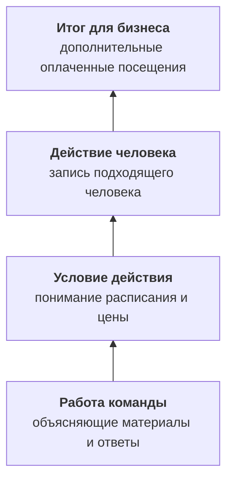

# Выбор показателей под задачу

Выбор показателей начинается с решения, которое нужно принять. Компания может хотеть заполнить свободные места на занятиях, снизить число повторных вопросов или познакомить закупщиков с новым продуктом. Во всех случаях публикации и реакции будут промежуточными результатами, а набор полезных измерений окажется разным.

Если цель сформулирована как «поднять вовлечённость», уточните ожидаемое изменение поведения. Обсуждения нужны, чтобы участники помогали друг другу? Чтобы обнаружить проблемы продукта? Чтобы люди разобрались в предложении? Ответ определяет, какие действия считать полезными и какой результат проверять дальше.

## Постройте цепочку результата

Разделите задачу на четыре уровня: доступный бизнесу итог, нужное действие человека, условия этого действия и работа команды. Для набора на занятия итогом могут быть дополнительные оплаченные посещения; действием — запись подходящего человека; условием — понимание расписания и цены; работой — объясняющие материалы и ответы.

На каждом уровне нужен ограниченный набор показателей. Итог помогает оценить ценность, промежуточный показатель обнаруживает препятствие, операционный показывает исполнение. Количество опубликованных материалов важно для управления производством, но само по себе не означает успех набора.

Не назначайте специалисту единоличную ответственность за итог, которым управляют несколько отделов. Доступность мест, подтверждение записи и качество занятия влияют на результат вместе с коммуникацией. При этом совместная ответственность требует владельцев данных и сроков передачи информации.

## Учебная карта показателей

Все числа и условия примера условные. Студия хочет продать 20 дополнительных посещений дневных занятий за четыре недели. В расписании есть 25 свободных мест; приоритет — жители соседнего района, которые могут приходить днём.

| Уровень | Показатель | Источник и момент оценки |
| --- | --- | --- |
| Итог | Дополнительные оплаченные посещения | Учёт посещений, после завершения пилота |
| Результат пути | Уникальные новые клиенты с оплатой | CRM, через 14 дней после обращения |
| Подходящий спрос | Уникальные обращения по дневному расписанию | Карточка обращения, ежедневно |
| Переход | Визиты на страницу дневных занятий | Аналитика сайта, еженедельно |
| Условие действия | Сколько участников небольшой проверки верно объяснили расписание и цену | Записи проверки понимания, до выпуска и после исправления |
| Исполнение | Ответы в согласованный срок | Журнал обращений, еженедельно |

Для последней строки сначала определите срок и рабочие часы. Доля своевременных ответов — количество новых обращений с первым содержательным ответом в установленный срок, разделённое на все новые обращения, для которых срок уже истёк. Автоматическое приветствие не заменяет помощь с выбором занятия.

## Если задача — понимание или узнаваемость

Коммуникация может помогать человеку разобраться в предложении или вспомнить компанию при выборе. Это отдельные результаты: просмотр показывает распространение материала, но не устанавливает, что человек понял его или запомнил автора. Для проверки нужны сведения от людей, которым адресовано сообщение.

### Проверить понимание

До выпуска перечислите смысловые элементы, которые человек должен унести: кому подходит предложение, какие условия существенны и что можно сделать дальше. Покажите материал нескольким людям из нужной группы и попросите объяснить его своими словами. Во время ответа не подсказывайте верную трактовку. Сохраните слова участника и место, где возникло затруднение.

Для студии из примера проверка может выглядеть так:

| Что проверяем | Задание человеку | Что записать |
| --- | --- | --- |
| Подходит ли расписание | «Расскажите, когда можно прийти на эти занятия» | Какие дни и время назвал, где искал ответ |
| Понятна ли цена | «Объясните, за что здесь нужно заплатить и что входит в эту сумму» | Верно понятые условия и пропущенные ограничения |
| Доступен ли следующий шаг | «Покажите, как вы стали бы записываться» | Найденный путь и место остановки |

Допустим, из шести участников двое приняли цену одного занятия за стоимость месяца. Это вымышленный результат, достаточный для конкретной правки: яснее подписать единицу оплаты и проверить новую версию. Он не означает, что треть всей аудитории ошибается. Если повторно приглашаете тех же людей, учитывайте, что они уже знакомы с материалом.

После публикации добавляйте к проверке повторяющиеся вопросы из [реестра обратной связи](/community/feedback-and-leads). Их содержание помогает находить непонятное, но снижение числа вопросов может объясняться и изменением аудитории или распространения.

### Проверить узнаваемость

Сначала определите, о какой группе нужен вывод: например, о жителях района, которым может потребоваться ремонт велосипеда. Опрос в собственном канале опишет ответивших подписчиков; по нему нельзя установить известность мастерской среди всех жителей.

В исследовании можно различать самостоятельное воспоминание и узнавание после подсказки. Сначала задать открытый вопрос: «Какие мастерские ремонта велосипедов в этом районе вы можете назвать?» Затем отдельно предъявить названия и спросить, какие знакомы. Это примеры вопросов для обсуждения метода, а не готовая проверенная анкета. Подсказка в первом вопросе изменит то, что вы измеряете; ответы на два вопроса не складываются в общую долю узнаваемости.

Сохраняйте способ приглашения, состав участников, формулировки и порядок вопросов, даты и число ответов. Для вывода о более широкой группе потребуется подходящий способ отбора и дизайн исследования. Небольшая добровольная проверка полезна прежде всего для обнаружения проблем и подготовки следующего исследования.

При повторном измерении обеспечьте сопоставимость метода и укажите другие изменения за период. Рост воспоминания или понимания сам по себе не доказывает вклад SMM: на людей могли повлиять реклама в других каналах, рекомендации и опыт использования. Причинный вопрос разбирается в [проверке гипотез](/analytics/experiments).

## Порог и исходное состояние

Целевое значение должно опираться на экономику, мощность и базовый уровень. Если студия обычно получает 15 записей в месяц из всех источников, цель «получить 20 записей из соцсетей» ещё не означает 20 дополнительных посещений. Часть клиентов могла бы записаться без пилота.

Сначала соберите исходное состояние за сопоставимый период: загрузку дневных занятий, обращения, оплаты, отмены и расходы. Отметьте праздники, изменение цены и другие кампании. Эти данные помогают интерпретировать результат, хотя обычное сравнение месяцев не изолирует причинный эффект.

Договоритесь о порогах решения до запуска. Например, если подходящие обращения поступают, но места не подтверждаются, команда проверяет запись и обработку. Если после заданного объёма распространения обращений мало, пересматривает аудиторию и предложение. Срок ожидания должен соответствовать времени принятия решения клиентом.

## Не дайте показателю испортить работу

Любая цель создаёт стимулы. План по числу комментариев можно выполнить провокациями, а план по дешёвым заявкам — слишком широким обещанием. Поэтому рядом с основным результатом нужны ограничения качества: доля неподходящих обращений, жалобы, отмены, возвраты или нагрузка поддержки.

Определите подходящее обращение заранее. В примере это новый человек из зоны обслуживания, которому подходит дневное расписание и нужна доступная услуга. Пять сообщений этого человека считаются одним обращением. После изменения определения пометьте разрыв ряда и пересчитайте прошлые значения, если данные позволяют.

## Рабочий договор об оценке

Запишите на одной странице цель, основной показатель, два или три объясняющих показателя, ограничения качества, период и ответственных. Для каждой цифры укажите числитель, знаменатель, источник и дату готовности. Отдельно перечислите то, чего учёт пока не видит.

На встрече обсуждайте решения по цепочке, а не рейтинг красивых чисел. Рост визитов при прежнем числе оплат требует проверки перехода к записи; рост оплат при большом числе возвратов — проверки обещания и продукта. Если данных недостаточно, результатом обсуждения становится конкретная задача по измерению, а не уверенное объяснение причины.

Показатели можно пересматривать, когда меняется задача или обнаруживается ошибка определения. Зафиксируйте причину и дату пересмотра. Смена цели после слабого результата без объяснения лишает команду возможности учиться на проверке.

Записать определения, окна, владельцев и условия решения можно в [карте показателей](/templates/measurement). Согласуйте её до запуска и используйте ту же версию при подготовке отчёта.
