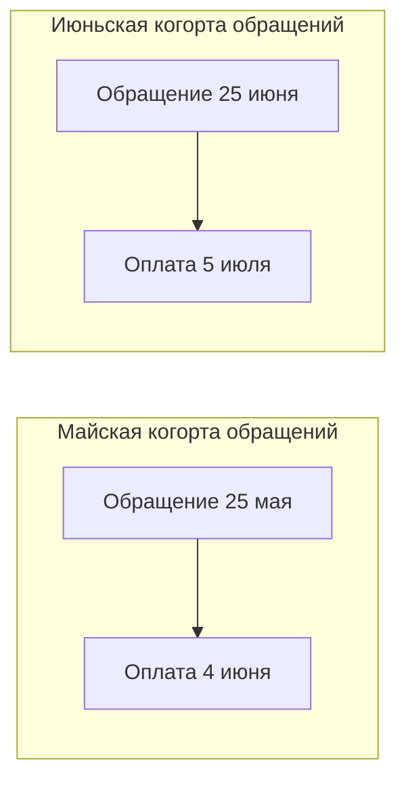

# Отчёты и сравнение площадок

Отчёт по SMM нужен для решения: что продолжить, что изменить и каких данных не хватает. Он соединяет выполненную работу, реакцию аудитории, результат бизнеса и расходы — близко к тому, как связывает эти уровни [модель оценки AMEC](https://amecorg.com/amecframework/). Набор скриншотов со статистикой может подтверждать отдельные числа, но не объясняет, какое действие следует из них.

Начните с читателя отчёта. Редактору нужны темы и поведение читателей; руководителю — движение к задаче, экономика и риски; команде продаж — качество и обработка обращений. Эти представления могут использовать одну базовую таблицу, сохраняя одинаковые определения.

## Подготовьте сравнимые данные

Выберите период размещений и срок дозревания результата. Например, оценивайте обращения, впервые пришедшие в июне, а их оплаты — в течение 30 дней после первого обращения. Июньская когорта будет полностью готова к анализу позже последнего дня июня.

Различайте отчёт о событиях месяца и отчёт о когорте. Оплаты в июне могут относиться к обращениям мая. Для кассового планирования это важно, но деление июньских рекламных расходов на все июньские оплаты может смешать разные группы.

Условный пример: оба человека оплатили через десять дней после обращения. Из-за разных дат входа их оплаты попали в разные календарные месяцы.

В отчёт о платежах июня попадёт первая оплата. В результат июньской когорты за 30 дней после обращения войдёт вторая, хотя деньги поступили в июле. Сначала выберите вопрос отчёта, затем группируйте записи по подходящей дате.

В заголовке таблицы укажите дату выгрузки, валюту, часовой пояс, модель атрибуции и состав расходов. Модель важно назвать: например, [Яндекс Метрика](https://yandex.ru/support/metrica/ru/reports/attribution-model) предлагает несколько моделей распределения конверсий между источниками. Общие затраты распределяйте по согласованному правилу или оставляйте отдельной строкой, если точного распределения нет.

## Учебная таблица результата

Все числа условные. В примере сравниваются две группы июньских обращений после завершения 30-дневного окна оплаты. Подходящее обращение — новый человек из зоны обслуживания с запросом на доступную услугу. Повторные сообщения объединены.

| Показатель | Площадка А | Площадка Б |
| --- | ---: | ---: |
| Расходы на размещения | 24 000 ₽ | 18 000 ₽ |
| Полные расходы выбранного объёма работ | 36 000 ₽ | 30 000 ₽ |
| Новые подходящие обращения | 40 | 20 |
| Новые клиенты с оплаченной услугой | 12 | 10 |
| Полная стоимость обращения | 900 ₽ | 1 500 ₽ |
| Полная стоимость нового клиента | 3 000 ₽ | 3 000 ₽ |

А даёт более дешёвое обращение, но меньшую долю оплат среди подходящих обращений: `12 / 40 = 30%` против `10 / 20 = 50%`. По полной стоимости клиента источники равны. Автоматически переносить бюджет в А на основании стоимости обращения было бы преждевременно.

Проверьте причины различия: одинаково ли менеджеры обрабатывали запросы, совпадает ли предложение, доступны ли нужные слоты. Возможна и случайная вариация: десять оплат недостаточно для уверенного обещания устойчивого преимущества.

## Свяжите отчёт SMM с результатом запуска

При [запуске продукта или набора](/funnels/launches) начните с общего реестра заказов, а затем покажите распределение по источникам. Различайте дату входа человека в базу, идентификатор запуска и источник по модели: покупатель из накопленной базы может оплатить после нового перехода из поиска.

Продолжим учебный запуск школы. На дату отчёта получено 20 оплат и два полных возврата; осталось 18 оплаченных мест на 360 000 ₽. Все заказы стоят по 20 000 ₽. В этой таблице используется последний непрямой переход за 30 календарных дней до оплаты; при отсутствии известных переходов источник остаётся неизвестным.

| Источник по модели | Места после полных возвратов | Сумма после возвратов |
| --- | ---: | ---: |
| SMM | 5 | 100 000 ₽ |
| Рассылка | 9 | 180 000 ₽ |
| Поиск | 2 | 40 000 ₽ |
| Неизвестный источник | 2 | 40 000 ₽ |
| Всего | 18 | 360 000 ₽ |

В известных историях 11 из этих 18 покупателей есть переход из SMM, включая пять заказов в строке SMM. Одиннадцать — отдельное наблюдение об участии в пути; оно не прибавляется к итогу таблицы. Общий бюджет кампании — 180 000 ₽, из него собственные расходы SMM — 70 000 ₽, а общие материалы — 60 000 ₽ отдельной строкой. Полный расчёт дан в главе о запуске.

Такой отчёт позволяет обсудить одновременно весь набор и работу канала. Он не доказывает, что SMM добавил пять или одиннадцать покупок. Перед изменением бюджета рассмотрите состав новой и накопленной базы, ограничения учёта и сценарии дополнительного эффекта.

## Показывайте уровни отдельно

Рядом с бизнес-результатом полезны данные распространения и поведения. Но просмотры видео одной площадки не следует напрямую сравнивать с просмотрами публикации другой. Разные определения делают рейтинг по общей колонке «просмотры» сомнительным.

Можно показывать исходные показатели каждой площадки отдельно, а сравнивать общий следующий этап: уникальные подходящие обращения, оплаченных новых клиентов или удержание подписчиков одинакового возраста. Даже эти результаты требуют общей методики и проверки качества источников.

Если общий уникальный охват неизвестен, так и напишите. Сумма охватов площадок не устраняет людей, которые видели обе. Скрытая потеря данных также должна быть видна: неизвестные источники обращений, неработавший счётчик и недоступная статистика размещения.

## От наблюдения к решению

Для каждого существенного изменения используйте связку: факт, возможное объяснение, следующая проверка, ответственный и срок. «Переходов стало меньше» — наблюдение. «Материал перестал быть интересным» — гипотеза. Проверка может включать сравнение распределения, темы, расположения ссылки и исправности страницы.

Не перечисляйте десятки гипотез без приоритета. Выберите ту, изменение которой даст полезный ответ при доступных ресурсах. Например, исправление сломанной формы важнее тестирования заголовка, пока заявки технически не проходят.

Покажите решения прошлой встречи и результат их выполнения. Иначе отчёт будет каждый месяц заново описывать одни и те же препятствия.

## Рабочий ритм

Оперативный обзор можно проводить еженедельно: расходы, исправность пути, обращения и необычные отклонения. Итоговую оценку делайте по мере созревания результата. Долгий цикл продажи требует обновления прежних когорт, а не объявления всех незакрытых обращений потерянными.

Назначьте владельца каждого решения и дату возврата к нему. Если требуется помощь другого отдела, сформулируйте задачу и ожидаемые данные, чтобы следующий отчёт проверял выполнение договорённости.

Храните исходную выгрузку и версию расчёта, чтобы итог можно было восстановить. В пояснениях отделяйте атрибутированные результаты от доказанного дополнительного эффекта. Завершайте отчёт конкретным решением о работе и бюджете, с условиями следующего пересмотра.
