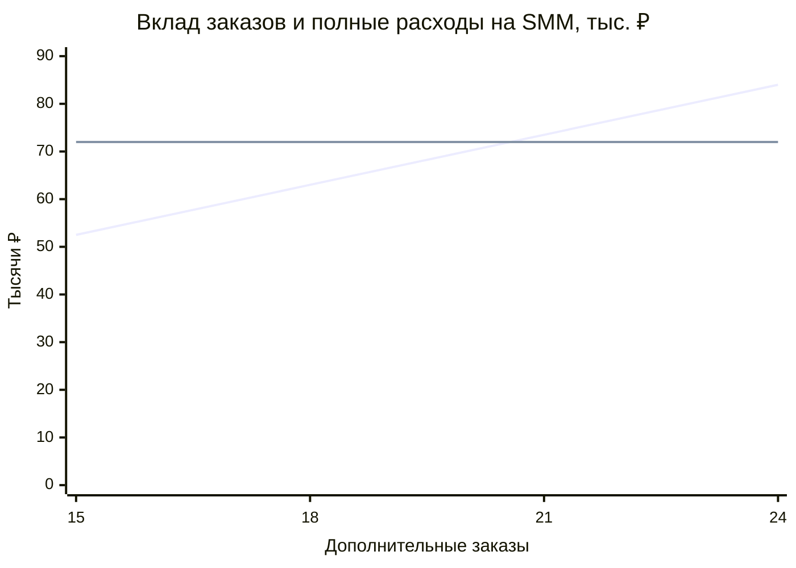

# Стоимость результата и окупаемость

Стоимость результата показывает, сколько ресурсов потребовалось для выбранного действия. Окупаемость связывает расходы с экономическим вкладом, который удалось получить. Эти расчёты помогают сравнивать варианты и определять допустимый бюджет, но требуют согласованных границ: что считается расходом, результатом и периодом.

Выручка не равна доходу, доступному для покрытия маркетинга. Выполнение заказа связано с материалами, оплатой работы, доставкой и другими переменными затратами. Кроме того, заказ с меткой SMM не обязательно является дополнительным: часть покупателей пришла бы и без кампании.

## Начните со состава расходов

Разделите расходы на размещения и полные затраты выбранного объёма работ. Во вторую группу могут входить производство, управление, модерация, сервисы, обработка обращений и распределённая стоимость времени сотрудников. Укажите, какие статьи включены и какие остались за границами расчёта. Расходы на размещения можно [передать в Яндекс Метрику](https://yandex.ru/support/metrica/ru/ad/expenses) с датой, источником и метками, но остальные статьи туда автоматически не попадут.

Общие затраты распределяйте последовательно. Если видео использовалось в четырёх каналах, нельзя записать полную стоимость производства в каждый и затем сложить итог. Возможны распределение по фактическому использованию или отдельная строка общих расходов; выбранное правило должно быть понятно читателю.

Не прячьте разовые расходы запуска внутри сравнения регулярной эффективности. Покажите результат с ними и без них, объяснив назначение обоих представлений. Для решения о первоначальном вложении важна полная сумма, для следующего месяца — ожидаемые повторяющиеся затраты.

## Учебный расчёт

Все числа далее условные. За месячный пилот компания потратила 40 000 ₽ на размещения, 20 000 ₽ на материалы и 12 000 ₽ на управление и обработку. Полные расходы составили 72 000 ₽. Зафиксировано 60 подходящих обращений и 24 новых клиента с завершённой оплаченной услугой.

| Показатель | Расчёт | Результат |
| --- | --- | ---: |
| Стоимость обращения по размещениям | 40 000 / 60 | 666,67 ₽ |
| Полная стоимость обращения | 72 000 / 60 | 1 200 ₽ |
| Полная стоимость нового клиента | 72 000 / 24 | 3 000 ₽ |

Каждый человек учитывается один раз в соответствующем результате. Период оплаты — 30 дней после первого обращения, и для всех людей это окно завершено. Незавершённые заказы не объявляются оплаченными ради улучшения показателя.

## Выручка и экономический вклад

Пусть средняя выручка услуги равна 6 000 ₽, а переменные затраты — 2 500 ₽. Вклад одного заказа до маркетинга и общих расходов составляет `6 000 − 2 500 = 3 500 ₽`. Двадцать четыре заказа дают 144 000 ₽ выручки и 84 000 ₽ такого вклада.

Отношение атрибутированной выручки к расходам на размещения равно `144 000 / 40 000 = 3,6`. Если называете его ROAS, прямо подпишите числитель и состав знаменателя. Значение 3,6 не означает прибыль в 260%: показатель не учитывает производство, выполнение услуг и другие расходы.

Для выбранной модели отдачи маркетинга можно рассчитать `(дополнительный вклад до маркетинга − полные расходы на SMM) / полные расходы на SMM × 100%`. Если все 24 заказа дополнительные, получится `(84 000 − 72 000) / 72 000 × 100% ≈ 16,7%`. Это ещё не прибыль бизнеса после всех общих расходов.

## Проверьте допущение о дополнительности

Если дополнительными являются только 18 заказов, вклад составит `18 × 3 500 = 63 000 ₽`. Остаток после SMM равен −9 000 ₽, а отдача по указанной формуле — −12,5%. Атрибуция сама по себе не позволяет выбрать между этими сценариями: модель атрибуции — это правило или алгоритм распределения конверсий между источниками, как её определяет [справка Google Analytics](https://support.google.com/analytics/answer/10596866?hl=en).

Точка покрытия маркетинговых затрат — минимум 21 дополнительный заказ: `72 000 / 3 500 ≈ 20,57`, округляем вверх. Сопоставьте её с мощностью компании. Если доступно лишь 15 заказов, первый цикл продаж не покроет заданный бюджет при такой модели.

На графике рост линии — вклад заказов по 3 500 ₽, горизонтальная линия — полные расходы 72 000 ₽. Линии пересекаются между 20 и 21 заказом.

Будущие повторы можно учитывать отдельным сценарием с конкретным горизонтом, долей возврата клиентов и расходами обслуживания. Прогнозируемая ценность клиента за годы не заменяет текущий денежный поток. Нужны фактические когортные данные и понятные допущения.

## Экономика запуска и работа SMM

Если SMM участвует в общем запуске, сначала посчитайте расходы и результат всей кампании, затем расходы канала и распределение заказов по выбранной модели. Продажи из накопленной базы требуют отдельного внимания: затраты текущей кампании не описывают всю стоимость её создания. Общие материалы учитывайте один раз. Подробный [пример запуска](/funnels/launches) соединяет эти расчёты с оплатами и возвратами.

Отношение расходов SMM к заказам, записанным ему по модели, можно использовать как показатель учёта с объявленными границами. Оно не показывает автоматически, насколько изменится общий результат при сокращении канала. Для следующего решения нужны сценарии дополнительного вклада и возможные последствия для остальных этапов пути.

## Решение о следующем вложении

Сравнивайте ожидаемые дополнительные расходы со вкладом дополнительного результата. Удвоение бюджета не обязано удваивать заказы: аудитория пересекается, цены размещения меняются, обработка упирается в мощность команды.

В отчёте покажите базовый, осторожный и благоприятный сценарии, срок возврата денег и неизвестные величины. Решением может быть ограниченное повторение, исправление обработки, снижение затрат или остановка. Если данных о причинном эффекте нет, так и напишите: рассчитана экономика атрибутированных заказов и сценарии, а доказанная окупаемость пока неизвестна.
