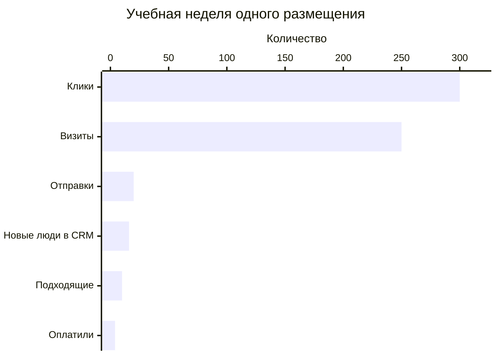

# Сбор данных и разметка ссылок

Сбор данных соединяет публикацию, переход и последующее действие человека. Для этого недостаточно установить счётчик: нужны согласованные названия источников, исправные ссылки, события на сайте и передача результата обращения. Тогда команда сможет разобраться, где прерывается путь и какие данные заслуживают доверия.

Разметка ссылки передаёт сведения о переходе. Она не подтверждает, что человек впервые узнал о компании именно здесь, и не доказывает дополнительный эффект размещения. Пользователь может переслать размеченную ссылку знакомому, вернуться другим способом или открыть её на другом устройстве.

## Спроектируйте минимальный учёт

Начните с вопроса, на который нужен ответ. Для пилота привлечения это может быть сравнение двух размещений по подходящим обращениям и завершённым заказам. Тогда нужны идентификатор размещения, дата перехода, успешная заявка, идентификатор обращения и итог заказа.

Составьте схему полей до публикации. Отдельно храните исходные значения, очищенные значения и принятые правила. Не исправляйте опечатку в названии источника молча: сохраните таблицу соответствий, чтобы следующий отчёт воспроизводился.

| Поле | Учебный пример | Для чего нужно |
| --- | --- | --- |
| Идентификатор размещения | june_author_a_01 | Связать расход и результат |
| Источник | author_a | Узнать, откуда пришёл переход |
| Способ распространения | paid_social | Отделить платное размещение |
| Кампания | june_workshop | Объединить связанные материалы |
| Вариант материала | case_video | Сравнить согласованные варианты |

Используйте небольшой справочник: один регистр, понятный разделитель и одно написание каждого значения. Имя источника не должно зависеть от того, кто сегодня собирает ссылку.

## Подготовьте ссылку и события

Для стандартной UTM-разметки источник обычно записывают в `utm_source`, способ распространения — в `utm_medium`, кампанию — в `utm_campaign`, вариант материала — в `utm_content`. Проверьте, как именно используемый счётчик принимает и показывает параметры: состав доступных отчётов зависит от системы. Значения полей и правила обработки для Метрики приведены в [официальной справке](https://yandex.ru/support/metrica/ru/general/source-tags.html); проверено 20 ноября 2026 года.

Учебная ссылка может выглядеть так: `https://example.com/workshop?utm_source=author_a&utm_medium=paid_social&utm_campaign=june_workshop&utm_content=case_video`. Адрес условный. Не добавляйте в параметры телефон, имя, адрес почты или текст частного обращения: ссылка попадает в журналы, историю и пересылки.

На сайте различайте нажатие кнопки, попытку отправки и подтверждённую отправку формы. Для результата «заявка» считайте успешное завершение, которое действительно создало запись. Иначе ошибка формы будет выглядеть как выполненная цель.

Для обращения в сообщениях заранее предусмотрите доступный способ связать источник с карточкой: отдельное ключевое слово, специальную ссылку или вопрос менеджера. У каждого способа есть потери; человеку должно быть легко начать разговор без прохождения лишнего опроса.

## Пройдите путь самостоятельно

До запуска откройте ссылку с мобильного устройства, пройдите перенаправления и отправьте тестовую заявку. Убедитесь, что параметры сохранились, событие появилось один раз, карточка создана, источник доступен менеджеру, а тест исключён из итогового отчёта.

Проверьте разные точки входа. Ссылка в описании, короткий адрес и ссылка внутри приложения могут вести через разные переходы. При изменении страницы повторите проверку: рабочий счётчик не гарантирует исправную форму.

В журнал проверки добавьте дату, устройство, адрес, ожидаемые поля и фактический результат. Это короткий рабочий документ, который помогает найти момент поломки после обновления сайта.

## Сведите данные без ложной точности

Все числа далее учебные. За неделю размещение дало 300 зарегистрированных кликов, 250 визитов сайта и 20 успешных отправок. После удаления повторных заявок в CRM осталось 16 новых обратившихся людей; десять признаны подходящими, четыре завершили оплату к дате отчёта.

Первые три столбца — события разных систем, последние три — уникальные люди в CRM. График показывает, где теряется объём, но не даёт права делить любые соседние значения друг на друга.

Для оценки обработки используйте 16 людей, для конверсии визитов в отправку — 20 визитов с отправкой, если подтверждено, что все отправки относятся к разным визитам. Если такой проверки нет, называйте числитель событиями отправки и не подменяйте им визиты. Покажите цепочку вместе с определениями.

Разницу между системами не нужно автоматически «исправлять» до совпадения. Счётчик сайта может не видеть часть посетителей, а CRM — сохранять обращения после другого устройства. Сверьте часовые пояса, фильтры, периоды и повторные события; оставшиеся ограничения запишите.

## Поддерживайте качество учёта

Назначьте владельца справочника и владельца передачи данных. Раз в неделю проверяйте долю обращений с неизвестным источником, дубли и внезапные пропуски. Отдельно храните дату выгрузки: оплаты и возвраты могут изменить результат прошлой когорты.

Учёт должен быть достаточным для решения и посильным для команды. Если половина обязательных полей остаётся пустой, сократите форму и автоматизируйте передачу доступных данных. Сложная таблица, которую не заполняют, даёт меньше пользы, чем простой воспроизводимый журнал.
