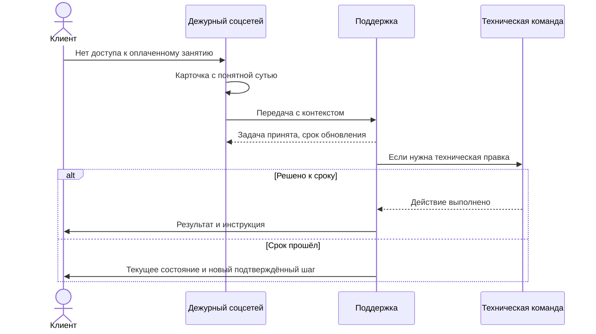

# Клиентский сервис

Клиентский сервис в соцсетях помогает человеку получить обещанную услугу, разобраться с затруднением и узнать, что произойдёт дальше. Для клиента аккаунт компании является частью компании: ему неважно, что сообщение читает маркетинг, а исправление зависит от другого отдела.

Поэтому сервис нельзя ограничить дружелюбными ответами. Нужен путь от сообщения до принятого решения, с владельцем, сроком и передачей контекста. SMM-специалист может принимать входящие и объяснять порядок, но не должен выдумывать полномочия на возвраты, ремонт или изменение договора.

## Определите границы помощи

Перечислите типовые вопросы: доступ, расписание, доставка, оплата, качество услуги, изменение заказа. Для каждого укажите, кто может ответить сразу, какие сведения нужны и куда передавать сложный случай. Назначение вопросов сотрудникам и заранее понятный порядок эскалации описаны, например, в [руководстве по соцсетям правительства Великобритании](https://www.gov.uk/guidance/social-media-playbook).

Опубликуйте часы работы и способ срочного обращения, если он предусмотрен. Не обещайте круглосуточную помощь без соответствующего дежурства. Автоматическое подтверждение получения сообщения полезно, когда объясняет следующий шаг, но не должно изображать решение.

Согласуйте полномочия первой линии. Например, сотрудник может проверить открытое расписание и выслать инструкцию, но решение о компенсации принимает руководитель сервиса. Чёткие границы ускоряют помощь: меньше времени уходит на поиск того, кто вправе действовать.

## Примите обращение

Первый ответ должен показать, какой вопрос принят. Уточняйте только сведения, необходимые для поиска ситуации. Не просите публиковать номер заказа, контакты и документы в открытых комментариях; предложите безопасный согласованный способ передачи.

Если человек уже описал проблему, не заставляйте повторять её в каждом канале: [ВКонтакте для бизнеса](https://vk.ru/@business-kak-biznesu-rabotat-s-negativnymi-otzyvami) тоже советует не собирать повторно сведения, которые уже есть. Передайте краткое описание и полученные данные следующему владельцу. Если доступ к переписке ограничен, объясните, что именно нужно подтвердить заново и зачем.

Отделяйте эмоцию от задачи. Раздражение может сопровождать обоснованную проблему. Спокойное признание затруднения и конкретный план полезнее спора о тоне, пока человек не нарушает правила общения.

## Учебный процесс передачи

Ситуация вымышленная: клиент не получил доступ к оплаченному занятию.

| Шаг | Ответственный | Подтверждение завершения |
| --- | --- | --- |
| Принять сообщение | Дежурный соцсетей | Есть карточка и понятная суть |
| Проверить оплату и доступ | Поддержка | Следующий владелец принял задачу |
| Исправить или объяснить ограничение | Поддержка либо техническая команда | Зафиксировано выполненное действие |
| Сообщить клиенту | Назначенный владелец | Клиент получил результат и инструкцию |
| Проверить повторение | Руководитель сервиса | Причина передана в улучшение процесса |

Пересылка в общий чат не завершает передачу. У задачи должен появиться конкретный владелец и срок следующего обновления. Если проблема не решена к сроку, клиенту всё равно нужно сообщить состояние и новый подтверждённый шаг.

Тот же процесс как последовательность передач:

## Закройте случай по результату

Ответ «информация передана» означает промежуточное состояние. Закрытие требует выполненного действия, понятного объяснения невозможности или согласованного дальнейшего порядка. Не помечайте случай решённым только ради уменьшения очереди.

При возможности уточните, смог ли человек воспользоваться результатом. Однако отсутствие ответа не всегда означает успех. Для таких случаев задайте отдельный статус и правило завершения, сохраняя возможность вернуться к вопросу без потери истории.

В публичной ветке можно сообщить допустимый итог без частных данных. Это помогает другим понять процесс и показывает, что компания не исчезла после приглашения написать лично. Содержание такого сообщения согласуйте с ответственным за случай.

## Измеряйте качество

Определите показатели отдельно для первого ответа и решения. Время первой реакции и время решения разделяет и [опыт агентства, опубликованный ВКонтакте для бизнеса](https://vk.ru/@business-kak-vystroit-kommunikaciu-s-auditoriei-v-soobschestve). Время решения включает всю передачу между отделами. Быстрый ответ первой линии не компенсирует неделю ожидания без движения.

Все числа далее учебные. За неделю поступило 50 новых сервисных случаев. У 40 согласованный срок первого ответа завершился; 36 получили содержательный ответ вовремя. Доля своевременных ответов — `36 / 40 = 90%`. Десять случаев, срок которых ещё не наступил, не входят в знаменатель.

Отдельно оцените долю повторно открытых случаев за 14 дней после закрытия, обращения по одной причине и просроченные передачи. Считайте случаи, объединяя сообщения по одной проблеме, и явно фиксируйте правило объединения. Число сообщений само по себе отражает нагрузку, а не число решённых проблем.

## Передавайте знания обратно

Собирайте повторяющиеся причины и конкретные примеры. Если многие не находят доступ, проверьте письмо, навигацию и состояние сервиса, а не только улучшайте текст ответа. Исправление причины может снизить обращения и одновременно улучшить опыт.

Обновляйте базу ответов после изменений продукта и проверяйте её с владельцами фактов. Хороший сервис соединяет точность, предсказуемый процесс и уважение к усилиям человека. Его результатом становится помощь, которую удалось получить, а не количество отправленных вежливых фраз.
