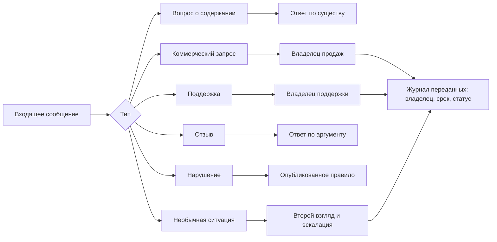

# Комментарии, сообщения и модерация

Модерация поддерживает условия, в которых люди могут разговаривать по предмету и получать помощь. Она включает ответы, маршрутизацию вопросов и применение правил. Удаление нарушений — только часть работы: важно также объяснять непонятное, снижать хаос и защищать возможность содержательного несогласия.

Комментарии видны многим и влияют на понимание компании. Личные сообщения подходят для индивидуального контекста, но могут создавать скрытую очередь. Команда должна знать, кто следит за каждым входом, в какие часы отвечает и куда передаёт вопрос, который сама не может решить.

Общий порядок от обращения до результата, включая коммерческий интерес из комментариев, разобран в главе о [работе с обратной связью](/community/feedback-and-leads). Здесь подробнее рассмотрены правила общения и решения модератора.

## Опубликуйте понятные правила

Правила должны описывать конкретное поведение: обсуждать тему, не публиковать чужие личные сведения, не оскорблять участников, не размещать несогласованную рекламу. Формулировка «администрация удаляет всё нежелательное» не помогает понять границы.

Разделяйте критику и нарушение. Сообщение «услуга не соответствует описанию» может быть неприятным, но предметным. Угрозы, раскрытие данных и навязчивый спам требуют иной реакции. Удаление обоснованного вопроса не устраняет проблему и способно усилить недоверие.

Заранее согласуйте последовательность действий: уточнение, предупреждение, ограничение и удаление в зависимости от тяжести. Для опасного содержания может потребоваться немедленная реакция. Правовые и технические подробности передавайте ответственным в рамках правил безопасности.

## Организуйте очередь

Разделите входящие по типу: вопрос о содержании, коммерческий запрос, поддержка, отзыв, нарушение и необычная ситуация. У каждого типа должен быть маршрут и владелец. Сообщение не считается обработанным только потому, что модератор поставил реакцию.

Схема показывает принцип: дежурный определяет тип, а дальше сообщение идёт по своему маршруту к владельцу.

Определите содержательный первый ответ. Он подтверждает понимание и даёт полезную информацию либо сообщает следующий шаг с конкретным сроком. Автоматическое приветствие показывает получение сообщения, но не заменяет решения.

Храните журнал вопросов, которые переданы дальше. Достаточны дата, ссылка или внутренний идентификатор, краткая суть, ответственный, обещанный срок и статус. При смене дежурного незавершённые случаи должны переходить вместе с контекстом.

## Учебная матрица действий

Ситуации ниже вымышленные и показывают порядок принятия решений, а не универсальную политику.

| Сообщение | Первое действие | Дальнейший шаг |
| --- | --- | --- |
| Вопрос о расписании | Дать актуальную информацию | Обновить описание при повторении |
| Жалоба на конкретный заказ | Признать вопрос и уточнить безопасный способ связи | Передать поддержке с владельцем |
| Предметное несогласие | Ответить по аргументу | Сохранить обсуждение открытым |
| Оскорбление участника | Применить опубликованное правило | Зафиксировать действие и объяснение |
| Публикация чужих данных | Ограничить распространение | Передать ответственному за безопасность |

Для спорного случая полезен второй взгляд. Модератор может ошибиться из-за неполного контекста или усталости. Назначьте человека, который быстро принимает решение по эскалации, и предусмотрите способ попросить пересмотр.

## Отвечайте без лишней обороны

Сначала отделите факт, оценку и запрос. «Опоздали на два часа, больше не обращусь» содержит возможный проверяемый факт и эмоциональный вывод. Ответьте на факт и объясните действие, а не спорьте с правом человека расстроиться.

Не используйте одинаковый формальный ответ независимо от ситуации. Шаблон помогает не забыть обязательные пункты, но должен адаптироваться к вопросу. Если информации пока нет, честно сообщите, что проверяется и когда будет обновление.

Перенос в личные сообщения нужен для частных деталей, а не для сокрытия всей темы. В публичной ветке можно обозначить принятие случая и позже сообщить допустимый итог без раскрытия данных.

## Измеряйте качество процесса

Все числа далее учебные. За неделю поступило 80 новых вопросов, для 60 из которых согласованный срок ответа уже завершился. Из этих 60 содержательный ответ вовремя получили 48. Доля соблюдения срока — `48 / 60 = 80%`. Остальные 20 ещё не должны попадать в знаменатель просрочки.

Отдельно смотрите незавершённые вопросы, повторные обращения по одной проблеме, долю передач без владельца и пересмотренные решения модерации. Большое количество удалений не является самостоятельным признаком качества: оно может означать плохо устроенный вход или слишком широкие правила.

## Поддерживайте команду и правила

Проводите короткий разбор сложных случаев и обновляйте примеры. Сохраняйте причины решений, чтобы разные дежурные применяли правила последовательно. При изменении существенных условий уведомляйте участников доступным способом.

Планируйте замещение и перерывы. Постоянное чтение конфликтов без поддержки снижает качество решений и делает процесс зависимым от одного человека. Посильные часы работы, ясная эскалация и помощь коллег важнее обещания отвечать мгновенно на любые сообщения.

Раз в месяц проверьте, доступны ли правила новым участникам и работают ли ссылки на помощь. Если человеку сложно найти порядок общения, часть повторяющихся конфликтов будет вызвана устройством самого сообщества, а не намеренным нарушением.
