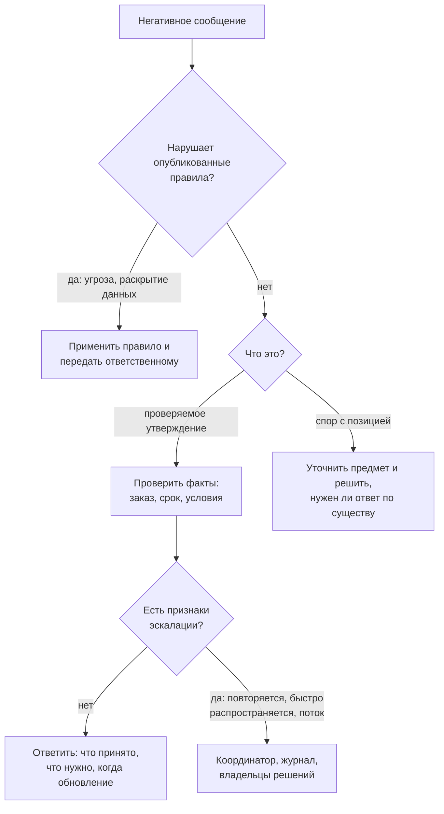
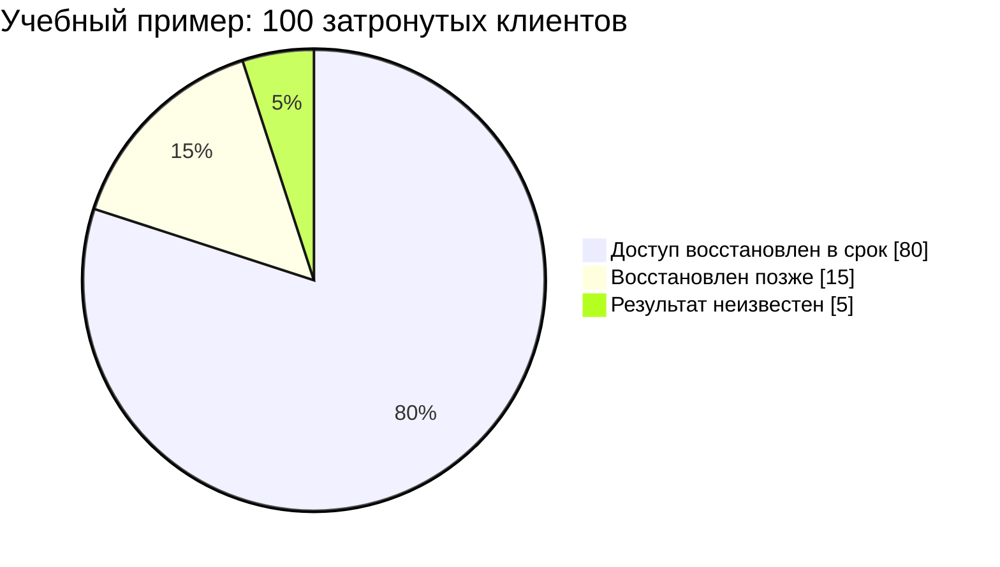

# Негатив, репутация и кризисы

Негативная реакция может сообщать о реальной проблеме, несовпадении ожиданий, ошибке в материале или конфликте ценностей. Репутационная работа начинается с различения этих ситуаций. Универсальный ответ «нам жаль, напишите лично» не заменяет проверку фактов и исправление причины.

Кризис отличается масштабом риска и потребностью в согласованных действиях. Например, множество людей одновременно не получает оплаченную услугу, распространяется существенная недостоверная информация или возникает угроза безопасности. Тогда одних усилий модератора недостаточно: нужны ответственные за продукт, операции, коммуникацию и другие затронутые области.

## Подготовьтесь до события

Определите признаки эскалации: повторяющаяся существенная проблема, быстрое распространение, участие внешних сторон, невозможность обычной поддержки справиться с потоком. Конкретные пороги зависят от размера компании и потенциальных последствий.

Назначьте координатора и резервного сотрудника. Сохраните контакты владельцев решений, порядок согласования и место рабочей записи. Команда должна знать, кто подтверждает факты и кто может разрешить изменение услуги, компенсацию или публичное сообщение.

Подготовьте простой журнал: время сигнала, подтверждённые факты, неизвестное, действия, владельцы и сроки обновления. Он помогает не потерять контекст при смене дежурных и не распространять предположения внутри компании как установленную истину.

## Разберите конкретное сообщение

Сначала выделите проверяемое утверждение и ожидаемое действие. Если человек сообщает о задержке, проверьте заказ и срок. Если спорит с позицией компании, уточните предмет и решите, нужен ли содержательный ответ.

Критика не равна нарушению правил. Не удаляйте неудобный, но предметный отзыв только потому, что он снижает привлекательность ленты. При угрозах, раскрытии данных и других нарушениях применяйте опубликованные правила и передавайте соответствующим ответственным.

Если утверждение пока не подтверждено, не называйте автора лжецом и не обещайте результат проверки заранее. Сообщите, что принято, какие сведения нужны и когда будет следующая информация.

Порядок разбора можно представить так:

## Учебная ситуация массового сбоя

Пример вымышленный: после обновления часть участников не может войти на оплаченный эфир. В соцсетях появляются повторные сообщения.

| Время и этап | Действие команды | Что можно сообщить |
| --- | --- | --- |
| Первые подтверждения | Проверить проблему и масштаб | Есть сообщения о затруднении входа, идёт проверка |
| Причина установлена | Назначить владельца исправления | Кого затрагивает проблема и доступный обходной путь |
| Работа продолжается | Обновлять состояние в обещанное время | Что изменилось, что пока неизвестно |
| Доступ восстановлен | Проверить результат и помощь пострадавшим | Как получить материал и куда обратиться |
| После события | Разобрать причину и предупреждение повторения | Подтверждённые изменения процесса |

Если срок восстановления неизвестен, не придумывайте точное время. Можно обещать следующую информационную точку, которую команда способна обеспечить. Просроченное обещание создаёт дополнительную проблему доверия.

## Организуйте публичную коммуникацию

Соберите актуальную информацию в одном доступном месте и ссылайтесь на неё из ответов. Это уменьшает расхождения и повторную работу. При изменении фактов помечайте обновление, а не незаметно заменяйте смысл прежнего сообщения.

Сообщение должно объяснять известную проблему, затронутую группу, действие компании и следующий шаг человека. Не включайте неподтверждённые причины, поиск виноватых и личные сведения клиентов. Правовые и технические формулировки проверяйте с соответствующими специалистами.

Сотрудникам дайте короткую внутреннюю инструкцию: что подтверждено, куда передавать новые случаи, какие обещания допустимы. При необходимости временно пересмотрите запланированную рекламу и развлекательные публикации с учётом ситуации и ресурсов команды.

## Оцените разрешение

Смотрите на фактическую проблему: восстановлен ли доступ, получили ли люди помощь, остались ли необработанные случаи. Снижение числа комментариев не обязательно означает решение; люди могут просто перестать ждать ответа.

Все числа далее учебные. Из 100 подтверждённых затронутых клиентов 80 получили восстановленный доступ в согласованный срок, 15 — позже, по пяти результат неизвестен. Доля своевременного восстановления — 80%, а неизвестные случаи следует показать отдельно. Нельзя объявлять успехом 95% только потому, что ответ отправлен 95 людям.

## Разберите причины и изменения

После стабилизации восстановите последовательность событий: сигнал, подтверждение, решение, сообщение, исправление. Определите, где потеряно время и какие обещания оказались неточными. Обсуждайте действия и процесс, а не назначайте удобного виноватого.

Для каждого улучшения задайте владельца, срок и проверку: обновить резервный доступ, изменить согласование, добавить контроль уведомлений. Репутация укрепляется через выполненные обязательства и исправленный опыт. Новая публикация с правильным тоном полезна, когда за ней стоит проверяемое действие компании.

Сохраните итоговый разбор и обновлённые инструкции в рабочем архиве. Проверьте их на коротком учебном сценарии с новым дежурным: может ли он найти координатора, передать случай и подготовить точное сообщение без догадок о порядке действий.
