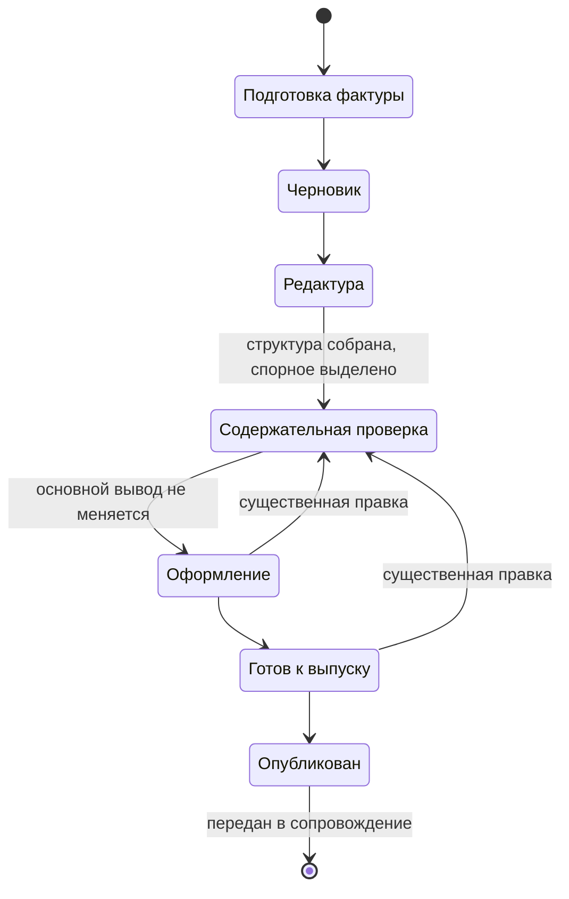

# Контент-план и производство

Контент-план связывает редакционные задачи с реальными сроками и исполнителями. Он показывает, что команда собирается выпустить, зачем нужен каждый материал и что мешает его готовности. Результат планирования — выполнимый набор публикаций с понятными входами, ответственными и порядком проверки.

Календарь с датами и заголовками — только видимая часть плана. За каждой публикацией стоят сбор фактуры, подготовка текста или записи, редактура, оформление и согласование. Если эти работы не учесть, календарь будет регулярно расходиться с выпуском.

## Начать с задач периода

Определите приоритет аудитории и бизнеса на выбранный период. Это может быть подготовка к сезонному спросу, объяснение новой услуги или помощь существующим клиентам. Уточните, какие материалы уже доступны и что можно обновить, прежде чем заказывать новые.

Соберите запас идей отдельно от утверждённого плана. Идея попадает в производство, когда понятны её польза, источник фактуры и доступный исполнитель. Для срочных публикаций оставьте запас времени, соразмерный частоте неожиданных задач. Не назначайте постоянный процент резерва без наблюдений за своей работой.

Учебный пример: образовательный проект готовит серию о выборе программы. Команда уже имеет ответы преподавателей и вопросы абитуриентов, но ещё не получила согласие выпускника на интервью. Подтверждённые материалы можно планировать, а интервью сначала проходит отдельную подготовительную задачу.

## Описать карточку материала

Карточка должна позволять другому участнику продолжить работу без восстановления контекста в переписке. Укажите аудиторию и её вопрос, главный ответ, роль в общей программе, формат, канал и следующий шаг. Добавьте ссылку на исходники, ответственного автора и проверяющего эксперта.

| Поле | Что записать |
| --- | --- |
| Читательская задача | Какое затруднение помогает решить материал |
| Фактура | Интервью, документы, данные, демонстрации |
| Результат производства | Текст, изображения, запись и необходимые версии |
| Критерии готовности | Что должно быть проверено перед выпуском |
| Ответственные | Кто готовит, проверяет и выпускает |
| Сроки | Передача фактуры, черновика, согласование и публикация |

Срок публикации определяйте после оценки предыдущих этапов. Обратное планирование помогает увидеть, что запрос эксперту нужен задолго до дня выхода. Если срок фиксирован внешним событием, объём материала должен соответствовать доступному времени.

## Провести материал через производство

Используйте несколько понятных состояний: подготовка фактуры, черновик, редактура, содержательная проверка, оформление, готов к выпуску, опубликован. Для каждого определите вход и результат. Например, переход в содержательную проверку означает, что структура уже собрана, а спорные утверждения выделены вопросами.

Не передавайте эксперту сырой документ с просьбой «посмотреть всё», если требуется проверить конкретные данные. Не отправляйте дизайнеру текст, в котором ещё меняется основной вывод. Параллельная работа возможна, когда участники понимают, какие части стабильны и где вероятны переделки.

Ограничьте число одновременно начатых материалов по реальной пропускной способности команды. Если редактор успевает обработать лишь часть поступающих черновиков, увеличение числа авторов создаст очередь. Сначала найдите задержку и согласуйте приоритеты.

## Организовать согласование

Договоритесь, что проверяет каждый участник. Эксперт отвечает за смысл и факты, владелец продукта — за условия предложения, редактор — за логику и ясность, выпускающий — за готовность всех элементов. В маленькой команде роли может совмещать один человек.

Укажите срок ответа и способ передачи замечаний. Комментарий должен объяснять проблему и, по возможности, предлагать проверяемое исправление. Вкусовое пожелание не должно незаметно заменять согласованную задачу материала.

После существенной правки спорное место возвращается соответствующему проверяющему. Молчание не считайте подтверждением точности. Если согласование задерживается, ответственный меняет дату или выбирает заранее подготовленный материал; публикация непроверенного обещания не решает проблему календаря.

## Подготовить выпуск и повторное использование

Перед публикацией проверьте окончательную версию, изображения, подписи, ссылки, условия предложения и действие после перехода. Сохраните опубликованный адрес и дату. Если запланированы адаптации, создайте отдельные задачи с собственными критериями готовности.

Публикация заканчивается передачей в сопровождение: кто отвечает на вопросы, собирает исправления и сообщает об обращениях. Для материала с ограниченным сроком актуальности назначьте дату пересмотра или снятия с публикации.

## Улучшать план по результатам

После периода сравните запланированное и выпущенное. Разбирайте причины: нехватка фактуры, поздняя смена задачи, ожидание эксперта, недооценка оформления. Отдельно учитывайте время участников, количество переделок и полезность готовых материалов для аудитории.

Если серия выходит стабильно, но не решает читательскую задачу, увеличение частоты не поможет. Если полезные материалы задерживаются на одном этапе, меняйте процесс. Хороший контент-план позволяет объяснить и содержание выпуска, и стоимость его подготовки, и причину каждого переноса.
