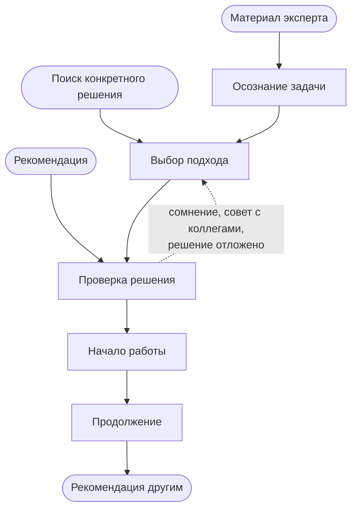

# Путь от первого контакта до рекомендации

Путь клиента описывает, как человек замечает задачу, ищет решение, выбирает, покупает и использует продукт. Соцсети участвуют в разных частях этого пути: знакомят с подходом, объясняют условия, помогают задать вопрос или поддерживают после покупки. Публикация не обязана немедленно продавать, но её роль должна быть понятной.

Модель пути нужна для обнаружения препятствий. Если человек понимает пользу, но не может найти цену, требуется одно исправление. Если предложение понятно, но не подходит по условиям, другое. Одинаковый призыв «оставьте заявку» не устраняет все причины отказа.

## Изучайте реальные ситуации

Начните с разговоров с клиентами, вопросов в сообщениях, данных поиска и причин отказов. Выясните, что происходило перед обращением, какие варианты рассматривались и что помогло принять решение. Просите конкретные эпизоды вместо общих мнений о хорошем маркетинге. Сочетать имеющиеся данные с интервью и наблюдением советует и [руководство GOV.UK по исследованию пользователей государственных сервисов](https://www.gov.uk/service-manual/user-research/start-by-learning-user-needs).

Восстановленная человеком история может быть неполной. Сопоставляйте её с доступными событиями, но не пытайтесь сделать из интервью точный журнал касаний. Несколько разговоров помогают находить механизмы и гипотезы, а не измерять доли всей аудитории; ограничения метода разобраны во [введении Nielsen Norman Group в интервью с пользователями](https://www.nngroup.com/articles/user-interviews/).

Разделите существенно разные ситуации. Новичок, впервые покупающий оборудование, и специалист, заменяющий известную модель, требуют разных объяснений. Формальная демография может совпадать, а путь выбора — отличаться.

## Постройте рабочую карту

Для каждого этапа запишите вопрос человека, препятствие, полезный материал, следующий шаг и владельца ответа. Не делайте схему подробной ради самой схемы: она должна помогать выбрать работу.

Учебный пример ниже относится к сервису, который помогает небольшим компаниям организовать внутреннее обучение. Это вымышленная ситуация.

| Этап | Вопрос человека | Помощь через SMM | Следующий шаг |
| --- | --- | --- | --- |
| Осознание задачи | Почему обучение не применяется в работе? | Разбор типичных препятствий | Проверить свою ситуацию |
| Выбор подхода | Нужен ли нам новый сервис? | Сравнение процесса с инструментом и без него | Обсудить условия команды |
| Проверка решения | Подойдёт ли это нашим сотрудникам? | Демонстрация на учебной ситуации | Запросить пилот |
| Начало работы | Как организовать первый запуск? | Инструкция и ответы | Провести первое занятие |
| Продолжение | Как оценить использование? | Разбор результатов и затруднений | Исправить процесс |

Материал на первом этапе может завершаться вопросами самопроверки, а на третьем — приглашением обсудить пилот. Обещание следующего шага должно соответствовать готовности человека и реальной возможности команды помочь.

## Свяжите этапы без лишнего трения

Проверьте переходы: что человек видит после ссылки, понимает ли связь с предыдущим материалом, нужно ли повторно искать обещанное. На сложном пути важно сохранять контекст между площадкой, сайтом и менеджером.

Не заставляйте проходить обязательную лестницу, если человек готов обратиться сразу. Входы бывают разными: рекомендация, поиск конкретного решения, материал эксперта. Оставьте быстрый доступ к условиям и разговору, одновременно помогая тем, кому нужно больше объяснений.

Путь после оплаты тоже требует владельца. Доступ, первый полезный результат, помощь с затруднением и возвращение создают опыт, на основании которого человек может рекомендовать продукт. Просьба об отзыве не заменяет этот опыт.

## Выберите измерения переходов

Считайте сопоставимые единицы: уникальных людей, визиты или события, в зависимости от вопроса. Доля обратившихся среди посетителей требует определения посетителя и окна обращения. Нельзя складывать просмотры публикаций и считать их числом людей на первом этапе.

Для длинного цикла используйте когорты первого обращения. Например, оценивайте пилот в течение 30 дней и оплату в течение 90 дней после обращения. Если окно не завершено, показывайте промежуточное состояние, а не окончательную конверсию.

Размеченный переход подтверждает наблюдаемый маршрут, но не показывает весь путь человека и не доказывает дополнительный эффект материала. Для приоритета исправлений часто достаточно факта препятствия; для бюджетных выводов ограничения важнее.

## Проверяйте карту в работе

Выберите один подтверждённый разрыв и устраните его. Например, люди после демонстрации не понимают порядок пилота. Добавьте объяснение состава, сроков и ответственности, затем наблюдайте обращения и вопросы в сопоставимом периоде.

Не перестраивайте одновременно все этапы без необходимости. Сохраните исходное состояние и причину изменения, чтобы команда могла связать новую работу с результатом. Назначьте дату пересмотра карты после накопления данных.

Путь редко бывает линейным: люди возвращаются к сравнению, советуются с коллегами и откладывают решение. Рабочая карта допускает эти возвращения и помогает быть полезным в нужный момент, сохраняя человеку возможность выбирать темп.

Этапы учебного примера с разными входами и возвращениями; места входа показаны условно:

