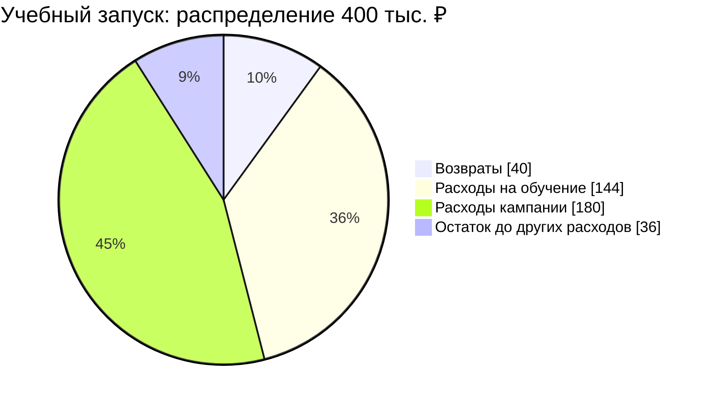

# SMM в запусках и кампаниях

Запуск — подготовка и вывод предложения к аудитории: нового продукта, набора на программу, мероприятия или сезонной услуги. У него есть общий результат, сроки и команда. SMM участвует в запуске вместе с продуктом, рекламой, рассылками и продажами: знакомит людей с предложением, помогает разобраться и поддерживает переход к покупке и использованию.

Например, школа открывает набор на практическую программу для руководителей. Человек может несколько месяцев читать её канал, зарегистрироваться на демонстрацию из письма, вернуться через поиск и оплатить после разговора с менеджером. Чтобы спланировать работу и оценить её, нужно видеть весь запуск и роль каждого участника.

Далее используется вымышленный запуск школы. Все сроки, суммы и количества — учебные. Предлагаемый порядок работы нужно адаптировать к продукту и команде; он не задаёт обязательную схему для любого бизнеса.

## Когда нужна отдельная кампания

Отделяйте запуск от регулярной работы, если у предложения есть особые условия: дата начала, ограничение мест, новый продукт или период приёма заявок. Укажите, что открывается, для кого, когда можно купить и что произойдёт после оплаты. Если продажи идут постоянно, материалы могут помогать выбирать продукт без общей даты открытия и закрытия.

Регулярный контент, ответы и сообщество продолжают обслуживать людей с другими задачами. В календаре выделите ресурсы запуска и сохраните необходимое сопровождение действующих клиентов. Не превращайте каждую публикацию в приглашение купить один и тот же продукт.

До старта согласуйте паспорт запуска: предложение, аудиторию, результат, даты, вместимость, бюджет, ответственных и правила учёта. Для школы это набор до 30 участников, начало занятий в установленную дату и цена 20 000 ₽. Цель по продажам нужно обосновать экономикой; число мест само по себе её не задаёт. Начинать планирование оценки с задачи организации, аудитории, показателя и срока предлагает и [руководство AMEC по планированию](https://amecorg.com/amecframework/home/supporting-material/planning/).

## Назначьте SMM роль на каждом этапе

| Этап | Задача аудитории | Работа SMM | Связь с командой и оценка |
| --- | --- | --- | --- |
| Подготовка | Понять, относится ли проблема ко мне | Разборы рабочих ситуаций, вопросы, объяснение будущего предложения | Продукт подтверждает содержание; команда проверяет понимание и собирает регистрации интереса |
| Знакомство с решением | Проверить, подходит ли способ обучения | Примеры заданий, демонстрация, ответы о нагрузке и требованиях | Эксперт готовит демонстрацию; учитываются регистрации, участие и оставшиеся вопросы |
| Продажи | Сопоставить условия и принять решение | Понятные условия, ответы, доступная ссылка на заявку или оплату | Менеджер принимает обращения; учитываются подходящие заявки, оплаты и отказы |
| После покупки | Начать обучение и решить затруднения | Навигация, напоминания о старте, передача вопросов поддержке | Учебная команда отвечает за доступ и обучение; учитываются начало работы и возвраты |
| Разбор | Получить обещанные материалы и дальнейший маршрут | Итоги, ответы на незакрытые вопросы, уместное продолжение | Команда сверяет результат запуска и принимает решения о следующем наборе |

Работу по объяснению предложения иногда называют прогревом. За этим словом должны стоять конкретные вопросы человека и полезные ответы. Не считайте подписку или просмотр доказательством готовности купить. Сообщайте реальные сроки и ограничения: завершение кампании в календаре не создаёт дефицит продукта.

## Свяжите каналы и ответственность

На время запуска согласуйте общую версию условий: состав продукта, цену, даты, ограничения и порядок возврата. Изменение должно попадать в публикации, письма, страницу предложения и ответы менеджеров. Владелец запуска принимает решение об изменении; SMM обновляет свои материалы и передаёт повторяющиеся вопросы.

В учебном запуске соцсети объясняют рабочие ситуации и приглашают на демонстрацию, рассылка доставляет подтверждение и обещанные материалы, сайт хранит условия и принимает оплату, менеджер помогает со сложными вопросами. Реклама приводит дополнительную аудиторию. Один человек может пользоваться несколькими каналами или сразу перейти к покупке.

Для каждого перехода назначьте владельца и проверьте путь: публикация → регистрация → подтверждение → демонстрация → предложение → оплата → доступ. Это проверка доступности маршрута, а не обязательная лестница для каждого покупателя. Сбой оплаты или отсутствие ответа нужно исправлять вместе с ответственным за этот этап.

## Разделите накопленную базу и аудиторию запуска

Зафиксируйте дату начала привлечения для запуска. В учебном примере она приходится за три недели до открытия продаж. «Новый для базы» — человек, чья первая известная регистрация произошла начиная с этой даты; «был в базе» — зарегистрированный раньше. Если дата неизвестна, оставьте отдельную группу. Новизна для базы не означает первую покупку: историю заказов проверяют отдельно.

Допустим, интерес зарегистрировали 160 уникальных людей. После оплат и возвратов распределение такое:

| Группа | Зарегистрировали интерес | Остались с оплаченной программой | Доля от зарегистрировавших интерес |
| --- | ---: | ---: | ---: |
| Новые для базы | 80 | 6 | 7,5% |
| Были в базе | 60 | 10 | 16,7% |
| Дата входа неизвестна | 20 | 2 | 10% |
| Всего | 160 | 18 | 11,25% |

Все покупатели примера входят в эти 160 регистраций, один человек покупает одно место. Данные зафиксированы на одну дату после завершения согласованного окна оплаты и проверки возвратов. Новые возвраты потребуют обновить отчёт.

Эти доли описывают группы, но не доказывают, что прежняя работа с базой вызвала разницу. У людей могли различаться потребности и готовность. Сравнивая запуски, учитывайте состав базы: одинаковая итоговая выручка может сочетаться с разным результатом привлечения новых людей.

## Сохраните историю касаний

В карточке различайте дату и источник первого известного входа в базу, переходы текущего запуска и источник, которому модель присвоила продажу. Идентификатор запуска связывает регистрации, заказы и расходы; он не заменяет источник перехода.

В нашей истории человек впервые зарегистрировался из соцсетей пять месяцев назад. В текущем запуске он перешёл из канала, затем из письма и поиска, а оплатил прямым заходом. Последний переход запишет покупку прямому заходу, другая модель — например, одна из [моделей атрибуции Метрики](https://yandex.ru/support/metrica/ru/reports/attribution-model) — может выбрать другой источник. Разбор с числами — в [главе об атрибуции](/analytics/attribution).

Если SMM присутствовал в известной истории 11 из 18 покупателей, а последним источником был у пяти, покажите оба наблюдения отдельно. Пять входят в одиннадцать; складывать их нельзя. Наличие касания также не означает, что все эти покупки добавились благодаря SMM. Отсутствие зарегистрированного перехода не доказывает отсутствия контакта с материалами.

## Посчитайте экономику всего запуска

В учебном запуске 20 человек оплатили по 20 000 ₽, двое получили полный возврат. Поступления составили 400 000 ₽, возвраты — 40 000 ₽, сумма после возвратов — 360 000 ₽ за 18 оставшихся мест.

| Расход запуска | Сумма |
| --- | ---: |
| Размещения в соцсетях | 30 000 ₽ |
| Материалы и работа SMM | 40 000 ₽ |
| Рассылка и её подготовка | 20 000 ₽ |
| Поисковая реклама | 30 000 ₽ |
| Общие демонстрация и страница предложения | 60 000 ₽ |
| Всего | 180 000 ₽ |

Для упрощения переменные расходы на обучение составляют 8 000 ₽ на каждое из 18 мест; других переменных расходов, в том числе по возвращённым заказам, в примере нет. Остаток после этих расходов и кампании равен `360 000 − 18 × 8 000 − 180 000 = 36 000 ₽`. Это результат выбранного расчёта до остальных расходов школы, а не чистая прибыль или доказанный дополнительный эффект запуска.

Диаграмма показывает, как распределились 400 тыс. ₽ поступлений в том же учебном запуске. Суммы в легенде указаны в тысячах рублей; все четыре части вместе составляют исходные поступления.

Из 400 тыс. ₽ поступлений 40 тыс. ₽ вернули покупателям. После расходов на обучение и кампанию осталось 36 тыс. ₽ до остальных расходов школы. Расходы кампании здесь учтены один раз; их состав раскрыт в таблице выше.

В отчёте SMM отдельно видны его 70 000 ₽ расходов и зарегистрированные результаты. Общие 60 000 ₽ оставлены общей строкой: их нельзя полностью прибавить к каждому каналу, а затем сложить затраты. Если нужно распределение, заранее согласуйте основание и сохраните общий итог 180 000 ₽.

Прежние расходы на создание базы в эту сумму не вошли. Поэтому расчёт не показывает полную стоимость привлечения покупателей за всё время. Покажите известные затраты прошлых периодов отдельно; если их распределение неизвестно, обозначьте пробел. Порядок расчёта стоимости результата разобран в [главе об экономике](/analytics/roi).

## Завершите запуск общим разбором

Соберите результат запуска по единому реестру заказов, затем представление по источникам с указанной моделью и отдельно работу SMM на этапах. Данные соединяет [сквозная аналитика](/analytics/end-to-end), а пример итоговой таблицы приведён в [отчётности](/analytics/reports).

На встрече разберите, где возникли потери: неподходящая аудитория, непонятные условия, пропуск демонстрации, отсутствие ответа, ошибка оплаты или несоответствие продукта ожиданиям. Для следующего запуска выберите конкретные изменения с владельцем и сроком. Рост продаж относительно прошлого набора сам по себе не отделяет эффект SMM от цены, состава базы и работы остальных каналов.
