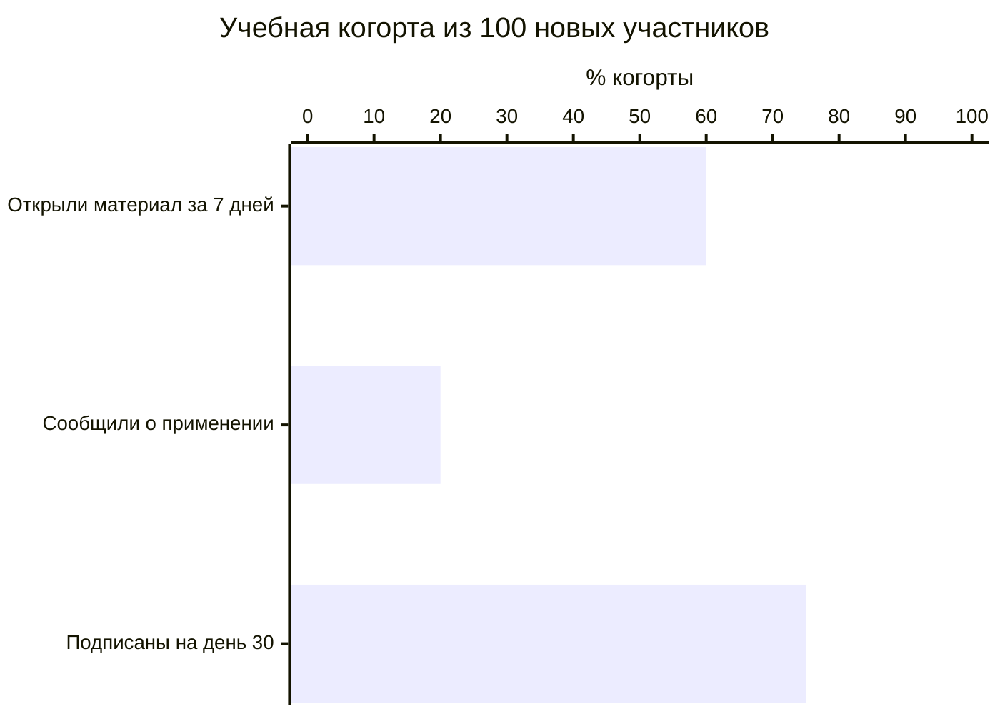

# Знакомство с новым подписчиком

Новый подписчик обычно знает о канале меньше, чем его постоянные читатели. Он мог прийти из одного материала, рекомендации или рекламного обещания и ещё не понимать общую тему, ритм и правила. Знакомство помогает быстро получить первую полезную вещь и решить, стоит ли оставаться.

Это не обязательная серия автоматических сообщений. В зависимости от площадки знакомство может состоять из описания, закреплённого материала, подборки, приветствия ведущего или первого ответа. Главное — провести человека от причины подписки к понятному опыту.

Новый подписчик не обязательно новичок в предмете или новый клиент. Опытному специалисту нужно объяснить устройство канала и подход компании, но основы темы могут быть ему уже известны. Предлагайте старт по текущей задаче; различия знакомства, опыта и отношений с продуктом разобраны в [исследовании аудитории](/strategy/audience#чем-новыи-подписчик-отличается-от-новичка).

## Выполните обещание входа

Сначала выясните, откуда приходят люди и чего ожидают. Если приглашение обещает шаблон, он должен быть доступен без поиска по архиву. Если человек вступает ради обсуждения практики, ему нужно объяснить, как принести свою ситуацию и чего ждать от участников.

Проверьте соответствие названием и описанием. Новый читатель не обязан понимать внутренние сокращения, историю компании и названия рубрик. Короткое объяснение предмета полезнее декларации «всё самое интересное».

Не начинайте знакомство с требования к человеку: прочитать десятки публикаций, заполнить длинную анкету и немедленно купить. Сначала дайте обещанную пользу. Дополнительные действия должны иметь понятную причину и оставлять возможность отказаться.

## Соберите стартовый маршрут

Хороший маршрут отвечает на четыре вопроса: о чём это место, кому полезно, с чего начать и как взаимодействовать. Достаточно нескольких материалов с разными ролями, а не всего архива.

Для профессионального медиа это могут быть вводный разбор, практическое упражнение и пример применения. Для компании — объяснение подхода, условия услуги и ответы на частые вопросы. Для сообщества — правила, пример хорошего запроса и ближайшая общая активность.

Каждая ссылка должна иметь подводку: какую задачу поможет решить материал. Название рубрики само по себе редко достаточно. Проверьте, что содержание открывается, не устарело и понятно без нескольких предыдущих выпусков.

## Учебное приветствие

Пример ниже вымышленный: канал помогает начинающим руководителям организовывать работу команды.

> Здесь разбираем повседневные задачи руководителя: встречи, договорённости и обратную связь. Если пришли за шаблоном повестки, начните с закреплённого разбора. В нём есть пример заполнения и упражнение для вашей встречи. Вопросы по применению можно оставить под материалом; сложные ситуации разбираем без личных данных сотрудников.

После такого приветствия маршрут может состоять из трёх шагов: получить шаблон, попробовать на одной встрече, вернуться с вопросом. Он конкретнее, чем предложение немедленно освоить весь менеджмент, и позволяет получить первый результат.

Если аудитория состоит из нескольких сегментов, предложите выбор маршрута: «первый опыт руководства» и «пересборка регулярных встреч». Не создавайте десяток вариантов, если команда не сможет поддерживать их актуальность.

## Организуйте первые касания

Согласуйте, кто отвечает новым участникам и где хранится информация о типичных затруднениях. Не обещайте индивидуальную помощь каждому, если ресурсов хватает только на общий разбор раз в неделю.

Сделайте ритм прозрачным. Человеку полезно знать, когда выходят материалы и насколько активно обсуждение. Большое число приветственных уведомлений может мешать, особенно если он пришёл только за одной конкретной вещью.

В открытом сообществе ведущий может первым показать пример содержательного вопроса и уважительного ответа. Не публикуйте вымышленные истории от имени участников. Настоящее участие развивается через доступную пользу и предсказуемое поведение команды.

## Как измерять знакомство

Выберите признак первой ценности: применение шаблона по добровольному ответу, просмотр стартового материала, участие в обсуждении или завершение первого действия в продукте. Различайте события и уникальных людей, а также технически доступные наблюдения и предположения.

Все числа далее учебные. Из 100 новых участников, которых удалось выделить в когорту, 60 открыли стартовый материал хотя бы раз за семь дней, 20 сообщили о попытке применения, 75 сохранили подписку на тридцатый день. Соответствующие доли исходной когорты — 60%, 20% и 75%.

Столбцы показывают разные события, а не последовательные шаги воронки: подписку на тридцатый день сохранили и те, кто не открывал стартовый материал.

Открытие не доказывает чтение или применение. Добровольный ответ не показывает все попытки: часть людей не сообщила о работе. Удержание требует завершённого 30-дневного окна для каждого участника и доступного способа отслеживания когорты.

## Улучшайте по затруднениям

Соберите повторяющиеся вопросы новых людей: где найти материал, с чего начать, куда писать, почему обещанное не открывается. Исправьте наиболее частое препятствие и проверьте следующие сопоставимые когорты.

При сравнении учитывайте источник входа и дальнейший контент. Если одновременно пришла другая аудитория и изменился маршрут, нельзя уверенно приписать изменение удержания только приветствию. Сохраняйте версии стартового материала и регулярно обновляйте ссылки, чтобы знакомство оставалось полезным и через несколько месяцев.
