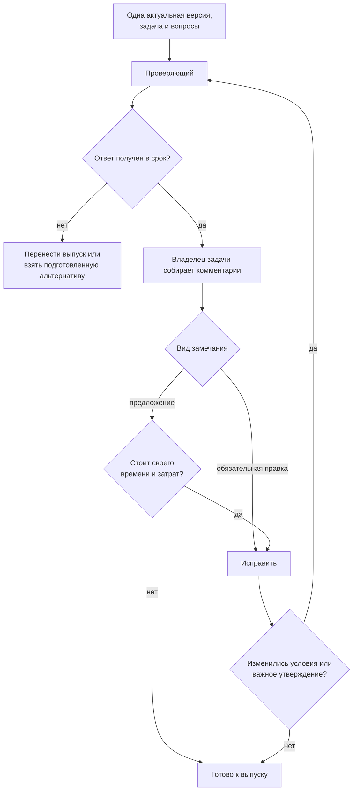

# Производство, согласования и контроль качества

Рабочий процесс превращает задачу SMM в проверенный результат: публикацию, размещение, ответ человеку или отчёт. Он задаёт порядок передачи работы, критерии готовности и действия при отклонениях. Цель — обеспечить качество и предсказуемость без избыточных согласований.

Начните с одного типичного вида задачи и пройдите его от запроса до завершения. Зафиксируйте, какие сведения нужны на входе, кто делает следующий шаг и где возникают ожидания. Автоматизировать или усложнять процесс стоит после понимания этих переходов.

## Определить вход в работу

Запрос должен объяснять проблему, аудиторию, ожидаемый результат, срок и ограничения. Фраза «нужно срочно сделать пост» не позволяет оценить ни содержание, ни приоритет. Ответственный уточняет, что изменится для аудитории и почему требуется именно этот срок.

Используйте единое место учёта задач с владельцем и текущим состоянием. Переписка может помогать обсуждению, но решение, исходники и сроки должны возвращаться в карточку. Иначе участники будут работать по разным версиям договорённости.

Учебный пример: отдел продукта просит объявить обновление. До включения в выпуск команда проверяет, доступна ли функция, кому она полезна, какие условия изменились и кто ответит на вопросы. Если запуск ещё не подтверждён, задача остаётся в подготовке.

## Задать этапы и результаты

Опишите небольшое число состояний, которые отражают реальную работу: уточнение, подготовка, проверка, готовность к выпуску, выполнение, оценка. Для контента внутри подготовки могут быть дополнительные этапы, но общая доска должна оставаться понятной.

У каждого перехода есть критерий. «На проверке» означает, что результат собран и понятно, что требуется проверить. «Готово к выпуску» означает, что обязательные подтверждения получены, ссылки работают и ответственный за сопровождение известен.

Не считайте задачу завершённой только после создания файла. Для размещения нужно подтвердить публичный выход, для обращения — передачу и принятие, для отчёта — обсуждение решения. Определение завершения должно соответствовать исходной задаче.

## Разделить проверки по риску

Не все материалы требуют одинакового числа согласований. Для повторяющихся ответов по утверждённой инструкции достаточно проверки актуальности. Для нового обещания, экспертной рекомендации или использования клиентской истории нужны соответствующие владельцы содержания.

| Вид проверки | Что устанавливает |
| --- | --- |
| Содержательная | Ответ раскрывает вопрос, условия и ограничения |
| Фактическая | Числа, цитаты и сведения подтверждены |
| Продуктовая | Предложение и следующий шаг доступны |
| Техническая | Ссылки, изображения, формы и публикация работают |
| Специальная | Спорные права, обязательства и доступы рассмотрены ответственным |

Укажите, когда нужна каждая проверка и кто её выполняет. Это точнее, чем правило «всё утверждает руководитель», которое может задерживать выпуск и не гарантирует профессиональной проверки.

## Сделать согласование управляемым

Передавайте проверяющему одну актуальную версию, описание задачи и список вопросов. Согласуйте срок ответа и запасной порядок при отсутствии человека. Комментарии собирает владелец задачи, чтобы автор не получал несовместимые требования из разных каналов.

Разделяйте обязательную правку и предложение. Обязательная связана с ошибкой, невыполненным критерием или подтверждённым ограничением. Предложение улучшает подачу, но требует оценки стоимости и влияния на срок.

После изменения условий или важного утверждения возвращайте затронутую часть на проверку. Не считайте старое согласование подтверждением новой версии. Если срок истёк, перенесите выпуск или используйте подготовленную альтернативу, соответствующую задаче.

Цикл согласования целиком:

## Управлять очередью и срочностью

Приоритет определяет владелец направления с учётом влияния, срока и затрат. Срочная задача должна явно вытеснить другую работу или получить дополнительные ресурсы. Иначе ускорение существует только в ожиданиях руководителя.

Ограничивайте число задач в работе. Большое количество начатого увеличивает переключения и время ожидания. Если очередь растёт перед одним участником, посмотрите, можно ли улучшить вход, разделить проверку или уменьшить объём выпуска.

Для повторяющихся действий используйте короткие контрольные списки. Они должны предупреждать реальные ошибки, а не дублировать весь процесс. Раз в период удаляйте пункты, которые не помогают решениям, и добавляйте обнаруженные важные проверки.

## Контролировать результат после выполнения

Проверьте публикацию или действие со стороны пользователя. Кабинет может показывать успешную загрузку, а ссылка оказаться недоступной. Ответ в комментарии может быть отправлен, но не решать вопрос человека. Владелец задачи подтверждает фактический результат.

Назначьте порядок исправления ошибок: кто принимает сигнал, оценивает последствия, меняет материал и сообщает затронутым участникам. Сохраняйте причины и связанные версии, чтобы одна правка не оставила неточность в других каналах.

Оценивайте процесс по времени прохождения, ожиданиям, переделкам и дефектам после выпуска. Разбирайте причины без подмены анализа поиском виноватого. Улучшение считается полезным, когда команда быстрее получает нужный результат при сохранении точности и управляемой нагрузке.
