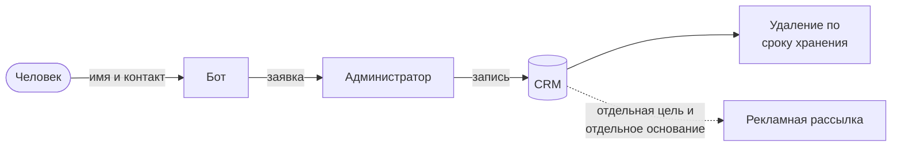

# Персональные данные и контакты аудитории

В SMM персональные данные появляются задолго до продажи: в сообщении клиента, форме регистрации, списке участников, фотографии и выгрузке рекламного кабинета. Работа с ними включает сбор, хранение, передачу и другие действия. Поэтому задача команды — управлять всем путём данных, а не только добавить ссылку на политику под кнопкой.

Глава относится к юрисдикции РФ; источники проверены 20 ноября 2026 года. Для конкретного проекта нужно определить применимость закона, категории данных и основания обработки. Зарубежные аудитории, чувствительные сведения и данные детей могут требовать дополнительной оценки.

## Сначала опишите путь данных

Нарисуйте или запишите маршрут: откуда поступают сведения, где сохраняются, кто получает доступ, кому передаются и когда удаляются. Учитывайте формы, ботов, CRM, почту, таблицы, сервисы аналитики и копии на устройствах сотрудников. Мессенджер как точка входа не отменяет дальнейшей обработки компанией.

Вымышленный пример: студия собирает заявки на пробное занятие. Человек оставляет имя и контакт, бот передаёт заявку администратору, затем запись попадает в CRM. Для такого процесса нужно определить ответственного, цель, необходимые сведения, доступы и срок хранения. Желание когда-нибудь отправлять рекламу — отдельная задача.

Маршрут из примера, нарисованный как схема:

Для каждого узла запишите ответственного, цель, состав сведений, доступы и срок хранения.

Сократите поля до необходимого. Для ответа на вопрос обычно не требуется паспорт, а для выдачи файла — сведения о семье. Не собирайте данные «на всякий случай»: каждое поле должно быть связано с понятным действием и допустимой целью.

## Определите основание и ответственность

Наличие согласия — одно из правовых оснований, но не единственное. В [письме Минцифры о применении закона № 152-ФЗ](https://storage.yandexcloud.net/comply-publicfiles/public/Otvet_Mintsifry_12.05.2025_lokalizatsija.pdf) отдельно указана необходимость основания при сборе данных. Выбирайте его по реальному процессу вместе с ответственным за персональные данные, а не копируйте форму соседнего сайта.

Определите оператора и роль подрядчика. Кто устанавливает цель, кто обслуживает форму, кто получает выгрузку и какие действия ему поручены? Эти отношения нужно отразить в договорённостях, доступах и описании процесса. Публичное обещание «данные никому не передаём» не должно противоречить фактической работе CRM или агентства.

До начала обработки проверьте обязанность уведомить Роскомнадзор и актуальность сведений оператора. Общую обязанность и обновление данных напоминает [сообщение управления Роскомнадзора на официальном сайте администрации](https://www.adm-nmar.ru/news/detail/18592/). Исключение должно иметь конкретное основание; маленькая компания сама по себе не является таким основанием.

## Если нужно согласие, фиксируйте его понятно

С 1 сентября 2025 года согласие на обработку персональных данных оформляется отдельно от иных подтверждаемых или подписываемых документов. Изменение объясняет [прокуратура Иркутской области](https://epp.genproc.gov.ru/ru/proc_38/activity/legal-education/explain/otherwise/e5978821/). Ссылка на политику и факт отправки формы не дают универсального ответа о соблюдении этой обязанности.

Подготовьте ясное описание цели, состава данных, действий и условий. Сохраните версию текста, дату и подтверждение волеизъявления в необходимом для процесса объёме. В отдельных случаях закон устанавливает специальную форму; обычный флажок не следует считать подходящим для любой категории данных.

Отдельно решайте рекламную рассылку. Согласие на запись, получение ответа или обработку обращения не означает автоматического согласия на рекламу. Требование предварительного согласия адресата и необходимость его доказать разъясняет [прокуратура](https://epp.genproc.gov.ru/ru/proc_65/activity/legal-education/explain/e702321/). Предусмотрите понятный отказ и процесс прекращения отправки.

## Публикация требует своей проверки

Разрешение обработать обращение не равно разрешению опубликовать отзыв с именем и фотографией. Для данных, разрешённых для распространения, предусмотрено отдельное согласие с условиями; соответствующую норму объясняет [официальное разъяснение по статье 10.1](https://epp.genproc.gov.ru/ru/proc_59/activity/legal-education/explain/e577614/).

Перед публикацией кейса, переписки или результата конкурса проверьте основания и объём раскрытия. Удаление имени не всегда обезличивает материал: должность, город, изображение и детали ситуации могут позволять узнать человека. Права на фотографию и согласие изображённого лица рассматривайте отдельно в рамках [работы с контентом](/safety/content-rights).

Не переносите контакты из публичного профиля в рекламную базу автоматически. Доступность сведений в интернете не определяет допустимость любого последующего использования. Для исследования аудитории предпочитайте агрегированные наблюдения, если идентификация людей не нужна.

## Проверьте хранение и сервисы

Для сбора данных граждан РФ учитывайте требования локализации и отдельно правила трансграничной передачи. Изменения с 1 июля 2025 года, работа с зарубежными базами и отдельный порядок уведомления о трансграничной передаче разобраны в том же [письме Минцифры](https://storage.yandexcloud.net/comply-publicfiles/public/Otvet_Mintsifry_12.05.2025_lokalizatsija.pdf). Согласие пользователя не заменяет проверку архитектуры обработки.

Попросите техническую команду подтвердить расположение баз, поток сведений, резервные копии и внешние интеграции. Учитывайте аналитические скрипты и сервисы автоматизации. Название тарифа или обещание поставщика «всё по закону» не заменяет описание вашего конкретного процесса.

Выдавайте доступ по ролям, исключайте общедоступные таблицы с заявками и не передавайте выгрузки в личные чаты без необходимости. Сроки хранения и уничтожения установите по цели и применимым обязанностям, учитывая копии и подрядчиков. Назначьте порядок работы с запросами человека об исправлении, доступе или прекращении обработки.

## Подготовьте реагирование

Сотрудник должен знать, кому немедленно сообщить о случайной публичной ссылке, отправке не тому адресату или захвате аккаунта. Ответственный оценивает инцидент и применимые обязанности уведомления; нельзя откладывать передачу внутри команды до окончания самостоятельного расследования.

Остановите дальнейшее раскрытие в пределах полномочий, сохраните сведения о времени и действиях, привлеките технических и правовых специалистов. Не обещайте клиентам «утечки точно не было», пока это не установлено.

Перед запуском механики проверьте весь маршрут на тестовых данных. Готовность означает понятную цель, основание, ответственность, ограниченные доступы и управляемое завершение обработки. Подготовленный документ без соответствующего процесса этой готовности не создаёт.
